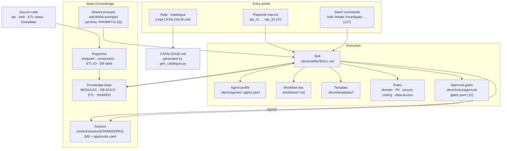
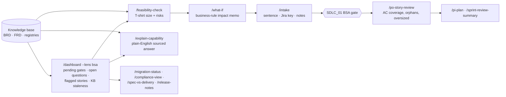
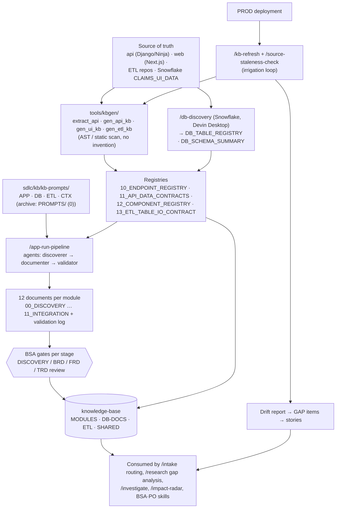
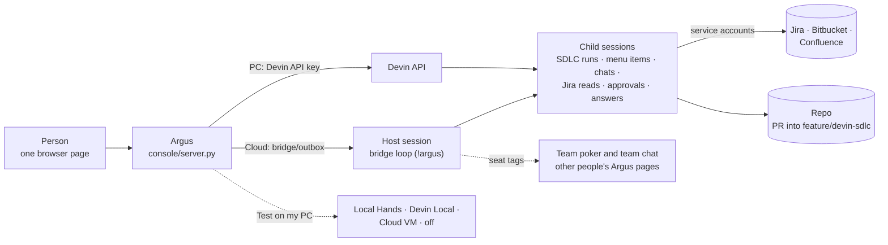

# Argus — Architecture

`{OWNER}` is resolved per `.devin/rules/session-isolation.md`.

How the pieces fit together. Counts come from `tools/validate_framework.py`; the per-item listing is
`CATALOGUE.md` (`/skills`, `/playbooks`, `/agents`).

| Layer | Where | Count | What it is |
|---|---|---|---|
| Playbooks | `sdlc/framework/playbooks/` | 37 | Devin Cloud macros (`!pb_*`) — start a session pre-loaded |
| Skills | `.devin/skills/<name>/SKILL.md` | 127 | Slash commands — the executable unit |
| Agents | `.devin/agents/*.agent.yaml` | 15 | Role profiles a skill adopts (goal, guardrails, allowed skills) |
| Workflows | `sdlc/framework/workflows/` | 10 | Stage-level procedure docs the stage skills follow |
| Rules | `.devin/rules/` | 28 | Domain context, approval gates, data access, PII, secure coding |
| Templates | `.devin/templates/` | 10 | Artefact shapes (spec, gap analysis, routing map, backlog schema, …) |
| Prompts | `docs/knowledge-base/Archive/PROMPTS/` | 0 | Archived older prompt copies; the live prompts are `sdlc/kb/kb-prompts/` |
| Knowledge base | `docs/knowledge-base/` | — | `MODULES/`, `DB-DOCS/`, `ETL/`, `SHARED/` — generated docs + registries |
| Session state | `sdlc/framework/context/session/{OWNER}/REQ-{id}/` | — | Per-requirement artefacts and `approvals.yaml` |
| Generators | `sdlc/framework/tools/` | 6 | `kbgen/*` (source→registry), `gen_catalogue.py`, `validate_framework.py` |
| Argus | `sdlc/framework/console/` | — | The web page that runs the SDLC from buttons; every action is a Devin Cloud session |

## Layering

## Flow 1 — SDLC pipeline (`/sdlc`)

Every stage writes into `context/session/{OWNER}/REQ-{id}/` and stops at a human gate; an unsigned gate blocks
the next stage.

```mermaid
flowchart LR
  I["/intake<br/>agent: intake (BSA)<br/>→ REQ-SPEC.md"] --> G1{{"SDLC_01<br/>BSA"}}
  G1 --> R["/research<br/>agent: research<br/>→ GAP-ANALYSIS, BACKLOG,<br/>ESTIMATION-AUDIT, JIRA-BACKLOG"]
  R --> G2{{"SDLC_02 / 02b BSA·PO<br/>SDLC_03 PO<br/>SDLC_03a Tech Lead"}}
  G2 --> P["/plan<br/>agent: plan<br/>→ ROUTING.md + insertion-points"]
  P --> G4{{"SDLC_04<br/>Tech Lead"}}
  G4 --> M["/implement<br/>agent: implement<br/>→ code, PR, AI-VERIFICATION"]
  M --> G5{{"SDLC_05<br/>Developer"}}
  G5 --> E["/eval<br/>agent: eval (QA)<br/>→ TEST-REPORT"]
  E --> G6{{"SDLC_06<br/>QA"}}
  G6 --> RE["/release<br/>agent: release<br/>→ DEPLOYMENT-PLAN + rollback"]
  RE --> G7{{"SDLC_07<br/>Release Mgr"}}
  G7 --> K["/kb-refresh<br/>agent: kb-refresh<br/>→ registries + KB docs"]
  K --> G8{{"SDLC_08<br/>Tech Lead"}}
  G8 --> KB[(Knowledge base)]
  X["/resume-session"] -.->|reads approvals.yaml| G4
```

Support skills used inside the pipeline: `/source-staleness-check` (before any gap analysis),
`/story-splitter` and `/grooming-assistant` (on flagged stories), `/security-audit` and
`/pr-readiness` (before SDLC_05), `/export-jira` (after SDLC_03a).

## Flow 2 — BSA / PO flow (read-only, no code)

Agents behind it: `business-analyst`, `po-planner`, `migration-analyst`. Nothing in this flow writes
code or signs a gate.

## Flow 3 — Knowledge base creation and irrigation

Two halves: deterministic generation from source (registries), and prompt-driven narrative documents.

## Flow 4 — Argus and Devin Cloud

Argus is one web page for the work people would otherwise type into chat. It runs in two places, and
in both of them every Start SDLC, menu item, approval, answer and handover is a Devin Cloud session that does
the work. The page only starts sessions, reads them and shows the result.

- **In Devin Cloud** (the team default). The person types `!argus` or `/argus` in their own Devin
  Cloud session. That session becomes their host: it starts the page and a small bridge loop, and the page
  opens through the session's preview link. A program on the VM can't call Devin's session tools, so the page
  writes each call to `~/.sdlc/console/bridge/outbox`; the loop runs it with the session's own tools and
  writes the answer to `bridge/inbox`. The sessions it starts are child sessions under the person's name, so
  nobody needs a personal Devin API key. The loop stops when someone types in the host session; the page then
  says the bridge is not running, and any message to the session starts it again.
- **On the person's PC.** The desktop icon starts the page with `SDLC_DEVIN_TRANSPORT=api`, and it calls the
  Devin API with the person's own key, kept in Windows Credential Manager.

What the pieces do:

- **Jira.** The page never holds a personal Jira key. With the service-account token on the machine it reads
  Jira directly; without it a short read-only session tagged `sdlc-jira-read` reads the lists. Jira writes are
  previews unless `SDLC_BACKLOG_WRITES=1`.
- **Sessions close when they are done.** A menu item's session is closed once it has posted its finished line.
  SDLC runs stay open, because they wait at gates. Chats share one assistant session per person per day
  (`workbench-assistant`).
- **Runs stay current.** Every 5 seconds one search asks Devin Cloud which open runs' sessions changed; those are
  read at once, whatever their status, so a question or gate shows within about 5–10 seconds.
- **Team poker and team chat** ride as tags on each person's host session (`sdlc-workbench-seat`). Every open
  Argus reads the team's seats every few seconds, so votes and short messages arrive without waking
  anyone's Devin agent. A chat message goes to one person (`@name`) or to the whole roster (`@everyone`). Only the PO and BSA start and reveal a poker round.
- **Test on my PC** runs one of four ways per person (`.devin/rules/workbench-settings.yaml`): Local Hands
  from the Cloud session (`devin connect <code>`, each step approved on the PC), Devin Local on the PC, the
  Cloud VM, or off.
- **Status light.** The top bar shows whether Devin, Jira and Bitbucket answer; when one doesn't, one bar says
  so with a Retry button and the last ticket list stays on screen.

## Guarantees and limits

- `tools/validate_framework.py` is the deterministic check: skill frontmatter and triggers, agent YAML
  parse, `allowed_skills` resolution, playbook→skill mapping, gate IDs, referenced paths.
- `tools/gen_catalogue.py` regenerates `CATALOGUE.md`, so `/catalogue` cannot
  drift from the files.
- Gates are advisory-free: a stage may not proceed past an unsigned gate, and gate records live in the
  session's `approvals.yaml`.
- `/db-*` skills and the PowerShell hooks need Snowflake via Devin Desktop; Glue/Lambda ETL docs need
  the sibling repositories.
