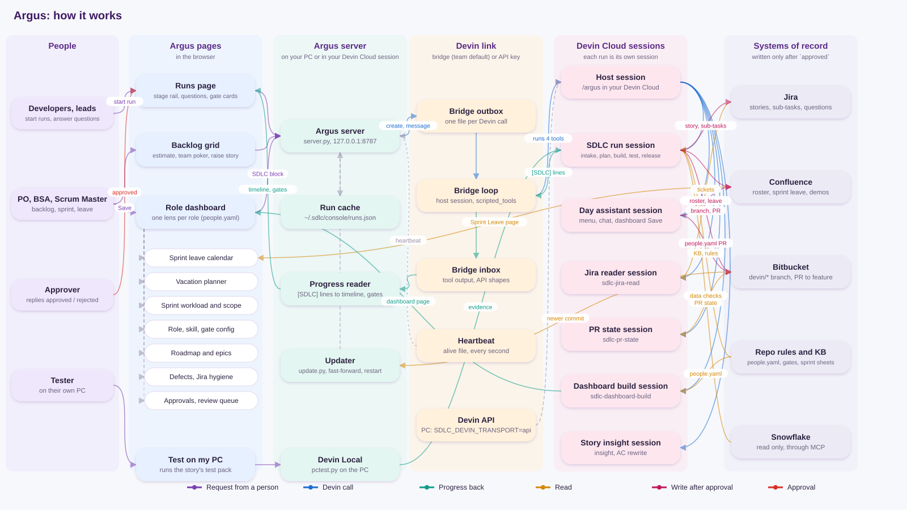

# Argus architecture pictures

One picture of how Argus works, in ten looks. It shows the people, Argus pages and the role dashboard with its tabs (sprint leave calendar, vacation planner and the rest), Argus server, the bridge to Devin, the host and child Devin sessions, and what each part reads from or writes to in Jira, Confluence, Bitbucket, the repo and Snowflake.

## Files

| File | Use it for |
|---|---|
| `workbench-architecture-06-pastel-still.png` | Slides and Confluence. The Pastel cards look, no animation, 3200 x 1800. |
| `workbench-architecture-06-pastel-still.svg` | The same still picture as a vector, for any size. |
| `workbench-architecture-01-purple.svg` … `-10-sequence.svg` | The ten animated looks. Open one in a browser; the dots play one role at a time. |
| `workbench-architecture-gallery.html` | All ten looks on one page, with a **Look** selector and a **Role** selector that loops one role. |

The ten looks are Acme Claims purple, Night neon, Blueprint, Swimlanes, Sketchbook, Pastel cards, Metro map, Executive grey, Hub and orbit, and Sequence story. Sequence story follows one run from start to finish instead of the four roles.

## How to read it

Line colours: purple is a request from a person, blue is a call to Devin, green is progress coming back, amber is a read, crimson is a write, and red is an approval. Nothing is written to Jira, Confluence or Bitbucket until someone replies `approved`.

**Developer or lead.** Starts a run on the Runs page. The server keeps the run in a small cache and writes a Devin call to the bridge outbox. The bridge loop in the host Devin Cloud session runs it with the session's own tools and creates the SDLC run session, which reads the repo rules, knowledge base and Snowflake (read only, through MCP). Its `[SDLC]` lines come back through the bridge inbox and turn into the stage rail and numbered questions. On a PC the same calls go straight to the Devin API with the person's key.

**PO, BSA or Scrum Master.** Opens the backlog grid; a short Jira reader session fetches the tickets. The dashboard build session reads `people.yaml` and builds the dashboard for that role, with its tabs such as the sprint leave calendar, which reads the Confluence Sprint Leave page. Save on a tab sends a SDLC block to the day assistant session, and after `approved` it updates the roster or leave page and raises a `people.yaml` PR.

**Approver.** Replies `approved` on the gate card. Only then does the run session write: Jira story and sub-tasks, Confluence pages, a `devin/*` branch and a PR into `feature/devin-sdlc`. The PR state session keeps the Runs page up to date, a person merges, and when Bitbucket has a newer commit the updater offers Update and restarts Argus.

**Tester.** Presses Test on my PC. Devin Local runs the story's test pack on the PC and sends the evidence to the run session, and the result shows on the Runs page.

The dashboard tabs in the picture are a sample; each role sees its own set (`.devin/rules/dashboard-roles.yaml`). The parts and links come from `console/server.py`, `console/bridge.py` and the roster, sprint leave and sprint sheet tools.

## Changing the pictures

Edit `tools/gen_workbench_architecture.py` (boxes are in `N`, links in `E`, the role journeys in `ROLES`, the looks in `THEMES`) and run it:

```
python3 sdlc/framework/tools/gen_workbench_architecture.py
```

Then make the PNG again from the still SVG with Chrome:

```
cd sdlc/framework/architecture
printf '<body style="margin:0"></body>' > /tmp/still.html
cp workbench-architecture-06-pastel-still.svg /tmp/
google-chrome --headless=new --hide-scrollbars --force-device-scale-factor=2 --window-size=1600,1200 --screenshot=/tmp/still.png file:///tmp/still.html
convert /tmp/still.png -crop 3200x1800+0+0 +repage workbench-architecture-06-pastel-still.png
```
