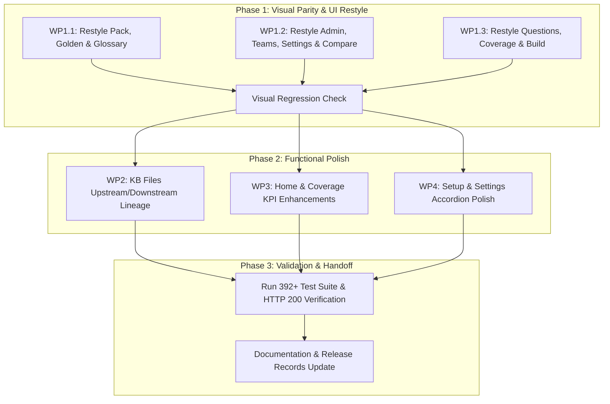

# Mētis 2.0.0 Implementation Plan

**Date:** 14 November 2026  
**Status:** WP1 and WP2 are done (14 Nov 2026, checked by screenshot and the 391-test suite). WP3 to WP8 are open.  
**Execution Strategy:** Local UI and orchestration changes execute directly in the workspace; model reasoning, repository scanning, and cloud build actions execute via Devin cloud worker sessions.

---

## 1. Overview & Execution Matrix

This implementation plan defines prioritized, dependency-ordered work packages (WPs) to close gaps identified in the Mētis 2.0.0 Gap Analysis. 

### Parallel Execution Rules
- Sub-agents (`spawn_subagent`) execute independent work packages operating on disjoint file sets.
- Maximum concurrent sub-agents: **3** (prevents context limits and tool starvation).
- Local tasks modify UI templates, routes, and tests; Devin tasks handle remote model reasoning and git integrations.

---

## 2. Work Packages Breakdown

### WP1: Mockup Layout & Pane Restyle (DONE)
- **Objective:** Restyle all 13 single-column screens to match the 21 mockup designs with compact list panes (`left_pane`), content workspaces, and inspector side panes (`right_pane`).
- **Files Touched:**
  - `metis-1.2.5-team (1)/tools/ui/views.py` (`questions()`, `coverage()`, `build()`, `setup()`)
  - `metis-1.2.5-team (1)/tools/ui/screens_pack.py` (`pack_view_screen()`)
  - `metis-1.2.5-team (1)/tools/ui/screens_golden.py` (`golden_view()`)
  - `metis-1.2.5-team (1)/tools/ui/screens_admin.py` (`audit()`, `teams_view()`, `settings()`)
  - `metis-1.2.5-team (1)/tools/ui/screens_compare.py` (`compare_view()`)
  - `metis-1.2.5-team (1)/tools/ui/screens_glossary.py` (`glossary_view()`)
  - `metis-1.2.5-team (1)/tools/ui/screens_usage.py` (`usage()`)
- **Tests Touched:** `tools/tests/test_ui_*.py`
- **Size:** **Medium (M)**
- **Dependencies:** None (Can run in parallel across modular screen files).
- **Execution Target:** **Local UI**

---

### WP2: KB Files View Graph Enrichment (DONE: upstream and downstream in the right pane when the graph file has the page's entity)
- **Objective:** Render upstream and downstream entity relations (`parsed` vs `ai-proposed` origin badges) in the `/files` right inspector pane using fast queries from `graph_store.py` (`.metis/graph.sqlite`).
- **Files Touched:**
  - `metis-1.2.5-team (1)/tools/ui/views.py` (`files()`)
- **Tests Touched:** `tools/tests/test_ui.py`
- **Size:** **Small (S)**
- **Dependencies:** WP1
- **Execution Target:** **Local UI**

---

### WP3: Home & Coverage KPI and Freshness Enhancements
- **Objective:** Add source freshness badges (Bitbucket, Jira, Confluence, Snowflake) and computed verification KPI ratios (citations pass rate, SQL parsed percentage) to Home and Coverage screens.
- **Files Touched:**
  - `metis-1.2.5-team (1)/tools/ui/views.py` (`home()`, `coverage()`)
  - `metis-1.2.5-team (1)/tools/ui/setup_ops.py`
- **Tests Touched:** `tools/tests/test_ui.py`
- **Size:** **Small (S)**
- **Dependencies:** WP1
- **Execution Target:** **Local UI**

---

### WP4: Setup & Settings Accordion Refinement
- **Objective:** Enhance `/setup` and `/settings` to display connection statuses with clear visual badges, environment definitions from `db-environments.yaml`, and role certifier listings.
- **Files Touched:**
  - `metis-1.2.5-team (1)/tools/ui/views.py` (`setup()`)
  - `metis-1.2.5-team (1)/tools/ui/screens_admin.py` (`settings()`)
  - `metis-1.2.5-team (1)/tools/ui/setup_ops.py`
- **Tests Touched:** `tools/tests/test_ui.py`, `tools/tests/test_ui_admin.py`
- **Size:** **Small (S)**
- **Dependencies:** WP1
- **Execution Target:** **Local UI**

---

### WP5: Devin Worker Task Queue & Clarification Polish (the round trip is built; this package is about timeouts and logging)
- **Objective:** Validate round-trip user clarification prompts, timeout handling, and task logging for background Devin worker sessions claiming `T-xxxx` tasks.
- **Files Touched:**
  - `metis-1.2.5-team (1)/tools/ui/tasks.py`
  - `metis-1.2.5-team (1)/skills/metis-tasks`
- **Tests Touched:** `tools/tests/test_ui.py`
- **Size:** **Small (S)**
- **Dependencies:** None
- **Execution Target:** **Local UI / Devin Cloud**

---

### WP6: Confidence Calibration & Rating Analytics
- **Objective:** Connect telemetry logs with feedback ratings to present Wilson score confidence interval calibration curves on `/usage`.
- **Files Touched:**
  - `metis-1.2.5-team (1)/tools/ui/calibration.py`
  - `metis-1.2.5-team (1)/tools/ui/screens_usage.py`
- **Tests Touched:** `tools/tests/test_ui_usage.py`, `tools/tests/test_telemetry_join.py`
- **Size:** **Small (S)**
- **Dependencies:** WP1
- **Execution Target:** **Local UI**

---

### WP7: Tree-Sitter Multi-Language Code Parsing (Roadmap / Next Release)
- **Objective:** Implement AST extractors for Java, TypeScript, and Python code to promote endpoint and handler edges from `ai-proposed` to `parsed`.
- **Files Touched:**
  - `metis-1.2.5-team (1)/tools/code_links.py` (New)
  - `metis-1.2.5-team (1)/tools/build_outputs.py`
- **Tests Touched:** `tools/tests/test_code_links.py` (New)
- **Size:** **Large (L)**
- **Dependencies:** Tree-sitter binaries / Python packages
- **Execution Target:** **Devin Cloud Session**

---

### WP8: Bitbucket PR Comment Automation (Roadmap / Next Release)
- **Objective:** Post generated review plan digests (`_PENDING/_QUEUE/*.md`) as comments directly to Bitbucket pull requests via REST API.
- **Files Touched:**
  - `metis-1.2.5-team (1)/tools/bb_pr.py` (New)
  - `metis-1.2.5-team (1)/tools/review_queue.py`
- **Tests Touched:** `tools/tests/test_bb_pr.py` (New)
- **Size:** **Medium (M)**
- **Dependencies:** Bitbucket repository credentials and branch configuration
- **Execution Target:** **Devin Cloud Session**

---

## 3. Parallel Execution Groups & Sequencing

### Allocation of First Execution Batch (Phase 1, already done):
1. **Agent Group A (`screens_pack.py`, `screens_golden.py`, `screens_glossary.py`):** Restyle context pack, golden questions, and glossary views with `left_pane` list and `right_pane` details.
2. **Agent Group B (`screens_admin.py`, `screens_compare.py`, `screens_usage.py`):** Restyle audit log, teams, settings, compare, and usage views with standard multi-pane layouts.
3. **Agent Group C (`views.py` - Questions, Coverage, Build, Setup):** Restyle core questions, coverage, build, and setup views.

---

*Implementation plan authored for Mētis 2.0.0.*
