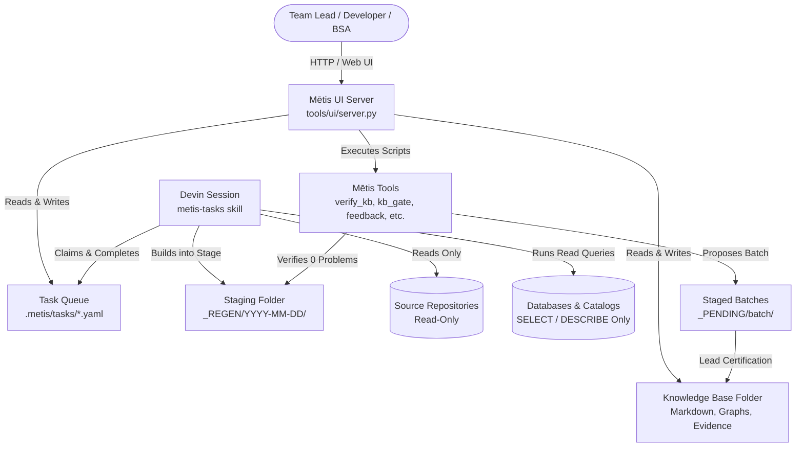
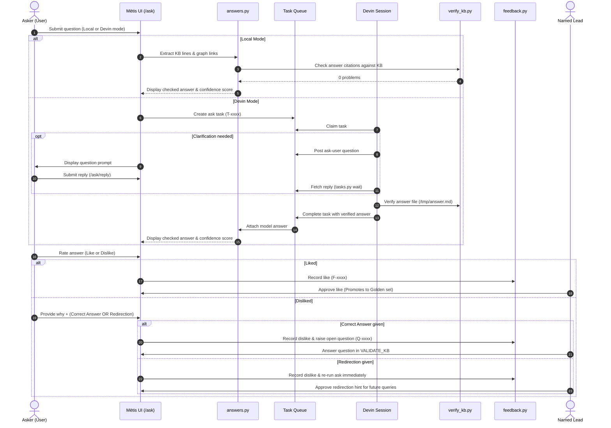

# Mētis 2.0.0 Manual

This manual explains Mētis (version 2.0.0), a verifiable knowledge base system and user interface for engineering, data, and architecture teams.

---

## 1. What Mētis Is and the Problem It Solves

Software and data ecosystems are complex and distributed. Teams struggle with three major challenges:
1. **Scattered knowledge**: System behavior is split across multiple repositories, database catalogs, ETL scripts, Confluence pages, and Jira tickets.
2. **Stale and unverified documentation**: Traditional wikis rot quickly, contain unverified assumptions, and risk leaking credentials or personal data.
3. **AI hallucinations**: General-purpose AI assistants guess facts or fabricate links when answering technical questions without direct evidence.

Mētis solves these problems by creating a strictly verifiable Knowledge Base (KB). Every single claim in Mētis carries an explicit evidence tag (`[E: ...]`) pointing to source code lines, saved database query outputs, saved ticket data, or uploaded documents. Unsupported assumptions (`[A]`) are strictly forbidden; any gap becomes an open question (`[?: Q-xxxx]`).

Mētis operates through two primary interfaces:
- **Mētis Web UI**: A lightweight Python web interface with dedicated screens (section 5) to configure profiles, detect technology stacks, orchestrate builds, inspect KB files, ask questions, answer team queries, certify batches, explore visualizations, and analyze coverage.
- **Devin Worker Integration**: Heavy reasoning and model generation steps are queued into `<KB>/.metis/tasks/` and executed asynchronously by Devin sessions using specialized Mētis skills.

Before the first build is locked, changes can be reviewed as a whole. Once the initial build is locked by a tech lead, Mētis enforces strict governance: nothing enters the live KB without explicit certification by a named lead.

---

## 2. Concepts

| Concept | Definition |
|---|---|
| **Knowledge Base (KB)** | The root directory containing evidence-backed Markdown documents, link graphs, ontology models, impact matrices, visualizations, and metadata. |
| **Source Tag (`[E: ...]`)** | An inline citation on a fact line or heading proving the statement against a source repository line range, saved query output, saved Confluence/Jira snapshot, uploaded file, or answered question. |
| **Open Question (`[?: ...]`)** | An explicit citation referencing an unresolved question entry in `_QUESTIONS/VALIDATE_KB.yaml`. Gaps in sources are never filled by guessing. |
| **Not in the KB** | A mandatory heading in generated answers and pages listing information that cannot be proven from existing sources. |
| **Lock** | The state transition performed by `kb_gate.py lock`. Once locked, direct writes to the live KB are prohibited. |
| **Lead** | An authorized individual named in `owners` (`kb_owner`, `app_owner`, `db_owner`, `etl_owner`, any role containing "lead") or `gate.certifiers` in the KB profile. |
| **Certify** | The formal approval action by a named lead that moves staged changes into the live KB, logging cryptographic hashes and approver identity. |
| **Batch** | A named staging directory (`<KB>/_PENDING/<batch>/`) holding proposed file additions, modifications, or deletions awaiting lead review. |
| **Confidence** | A deterministic 0–100 score and band (`High`, `Medium`, `Low`, `None`) computed by [`answers.confidence()`](metis-1.2.5-team%20(1)/tools/ui/answers.py:321) based on citation coverage, multi-line assembly, inferences, missing sections, and open questions. |
| **Devin Session & Task Queue** | A file-backed queue (`<KB>/.metis/tasks/`) where the UI posts background reasoning and build tasks for Devin sessions to claim and complete. |
| **Staging Folder** | An isolated directory outside the live KB (e.g. `<KB>/_REGEN/<run>/` or `<KB>/_PENDING/<batch>/`) where files are generated and verified before entering the KB. |

---

## 3. Architecture

### System Architecture Diagram



### Ask to Rating Lifecycle Diagram



### Complete Tools Reference Table

| Tool File | Location | Primary Purpose and Functions |
|---|---|---|
| [`server.py`](metis-1.2.5-team%20(1)/tools/ui/server.py:1) | `tools/ui/` | Web server hosting the core UI screens and dynamically loading modular `screens_*.py` files. |
| [`views.py`](metis-1.2.5-team%20(1)/tools/ui/views.py:1) | `tools/ui/` | Implements core screens (Home, Setup, Build, KB files, Ask, Questions, Approve, Coverage). |
| [`ui_common.py`](metis-1.2.5-team%20(1)/tools/ui/ui_common.py:1) | `tools/ui/` | Shared UI helpers, HTML escaping, Markdown rendering, navigation definitions, and tool execution wrappers. |
| [`answers.py`](metis-1.2.5-team%20(1)/tools/ui/answers.py:1) | `tools/ui/` | Local extractive Q&A, Devin answer attachment, confidence scoring, miss guidance, and rating dispatch. |
| [`tasks.py`](metis-1.2.5-team%20(1)/tools/ui/tasks.py:1) | `tools/ui/` | File-backed task queue (`list`, `show`, `claim`, `complete`, `fail`, `ask-user`, `wait`, `reply`). |
| [`builds.py`](metis-1.2.5-team%20(1)/tools/ui/builds.py:1) | `tools/ui/` | Orchestrates build stages, detects stale pages, generates run directories, and triggers post-build outputs. |
| [`setup_ops.py`](metis-1.2.5-team%20(1)/tools/ui/setup_ops.py:1) | `tools/ui/` | Saves profiles, executes stack detection, records stack approvals, and checks data sources. |
| [`calibration.py`](metis-1.2.5-team%20(1)/tools/ui/calibration.py:1) | `tools/ui/` | Computes confidence band calibration against user ratings with 95% Wilson score confidence intervals. |
| [`glossary.py`](metis-1.2.5-team%20(1)/tools/ui/glossary.py:1) | `tools/ui/` | Business glossary data store managing terms, synonyms, meanings, and KB page associations. |
| [`screens_admin.py`](metis-1.2.5-team%20(1)/tools/ui/screens_admin.py:1) | `tools/ui/` | Implements `/audit` (merged audit log), `/teams` (RBAC rights), and `/settings` (safe profile editing). |
| [`screens_compare.py`](metis-1.2.5-team%20(1)/tools/ui/screens_compare.py:1) | `tools/ui/` | Implements `/compare` for diffing live KB with staging folders and promoting selected files. |
| [`screens_glossary.py`](metis-1.2.5-team%20(1)/tools/ui/screens_glossary.py:1) | `tools/ui/` | Implements `/glossary` UI for browsing, searching, adding, editing, and deleting business terms. |
| [`screens_review.py`](metis-1.2.5-team%20(1)/tools/ui/screens_review.py:1) | `tools/ui/` | Implements `/review` queue with trust signals, per-team review planning, and sampling verification. |
| [`screens_usage.py`](metis-1.2.5-team%20(1)/tools/ui/screens_usage.py:1) | `tools/ui/` | Implements `/usage` displaying calibration accuracy, cited pages, look-first lists, and activity trends. |
| [`verify_kb.py`](metis-1.2.5-team%20(1)/tools/verify_kb.py:1) | `tools/` | Core verification gate checking all `[E: ...]` citations against sources; requires 0 problems to pass. |
| [`kb_gate.py`](metis-1.2.5-team%20(1)/tools/kb_gate.py:1) | `tools/` | Enforces certification gate (`lock`, `propose`, `digest`, `certify`, `reject`, `status`, `check`). |
| [`feedback.py`](metis-1.2.5-team%20(1)/tools/feedback.py:1) | `tools/` | Records likes/dislikes, redirects, and hints in `_FEEDBACK/FEEDBACK.yaml`. |
| [`questions.py`](metis-1.2.5-team%20(1)/tools/questions.py:1) | `tools/` | Manages the open question register (`VALIDATE_KB.yaml`), answering, raising, and HTML sheets. |
| [`mcp_server.py`](metis-1.2.5-team%20(1)/tools/mcp_server.py:1) | `tools/` | Exposes read and telemetry tools over stdio to AI agents using the Model Context Protocol. |
| [`trust.py`](metis-1.2.5-team%20(1)/tools/trust.py:1) | `tools/` | Generates raw trust signals (edge origin, quote verification, source git staleness, blocking questions). |
| [`telemetry.py`](metis-1.2.5-team%20(1)/tools/telemetry.py:1) | `tools/` | Logs KB page consumption by answers and context packs; generates usage and look-first reports, grouped by owning team (`gate.teams`) and by who recorded the use. File names only. |
| [`capture.py`](metis-1.2.5-team%20(1)/tools/capture.py:1) | `tools/` | Turns a pasted note into a page with one sourced line per line given, the exact text kept in `_EVIDENCE/files/`; staged in `_PENDING/` once the gate is closed. Refuses secrets. |
| [`onboarding.py`](metis-1.2.5-team%20(1)/tools/onboarding.py:1) | `tools/` | Reading path for a team, approver or role: pages, key graph objects, glossary terms and open questions. Writes nothing into the KB. |
| [`context_pack.py`](metis-1.2.5-team%20(1)/tools/context_pack.py:1) | `tools/` | Generates token-budgeted context packs for a task text (`--task`, hybrid search), Jira tickets or graph nodes with verbatim evidence, in full / section / headline tiers; `--tokenizer` for a real token count. |
| [`pack_eval.py`](metis-1.2.5-team%20(1)/tools/pack_eval.py:1) | `tools/` | Scores the context pack against the golden questions (recall, precision, hit@k, full-tier share) with a regression baseline and a CI gate. |
| [`features.py`](metis-1.2.5-team%20(1)/tools/features.py:1) | `tools/` | Registry of experimental features, each with the evidence needed to leave the list. The profile key `experimental.enable: [name, ...] | all` shows their screens in the menu. |
| [`audience.py`](metis-1.2.5-team%20(1)/tools/audience.py:1) | `tools/` | The four KB layers (meaning, rules, design, code), the five audiences and what each favours; `layers <kb>` shows which layer each page is read as, `who <kb> <person>` the audience Metis would use. |
| [`skill_lint.py`](metis-1.2.5-team%20(1)/tools/skill_lint.py:1) | `tools/` | Reports each skill's description size (always in context) and body size, flags writers that never cite the evidence rule, and finds near-duplicate skills and prompts. |
| [`doc_metrics.py`](metis-1.2.5-team%20(1)/tools/doc_metrics.py:1) | `tools/` | Counts tests, screens, tools and skills from the code and keeps the `metrics` blocks in the docs equal to them. |
| [`kb_coverage.py`](metis-1.2.5-team%20(1)/tools/kb_coverage.py:1) | `tools/` | Audits unreferenced graph objects, orphan catalog tables, rejected links, and blocking questions. |
| [`build_outputs.py`](metis-1.2.5-team%20(1)/tools/build_outputs.py:1) | `tools/` | Generates link graphs, ontology models, impact matrices, ERDs, and visual dashboards from verified files. |
| [`build_plan.py`](metis-1.2.5-team%20(1)/tools/build_plan.py:1) | `tools/` | Identifies stale KB pages based on git commits and tracks build stage checkpoints. |
| [`sql_links.py`](metis-1.2.5-team%20(1)/tools/sql_links.py:1) | `tools/` | Parses `.sql` and dbt files using `sqlglot` to extract verified table-level dependencies. |
| [`gen_graph.py`](metis-1.2.5-team%20(1)/tools/gen_graph.py:1) | `tools/` | Combines module links into `LINK_GRAPH.yaml` and `ONTOLOGY.yaml` with origin tags. |
| [`gen_matrix.py`](metis-1.2.5-team%20(1)/tools/gen_matrix.py:1) | `tools/` | Constructs `IMPACT_MATRIX.yaml` tracing upstream and downstream dependencies across layers. |
| [`graph_store.py`](metis-1.2.5-team%20(1)/tools/graph_store.py:1) | `tools/` | SQLite-backed link graph (`.metis/graph.sqlite`) for high-performance impact walks. |
| [`sensitive.py`](metis-1.2.5-team%20(1)/tools/sensitive.py:1) | `tools/` | Scans text to block secrets, tokens, credit card numbers, and SSNs, flagging PII for lead review. |
| [`review_queue.py`](metis-1.2.5-team%20(1)/tools/review_queue.py:1) | `tools/` | Risk-ranks pending files by team (`gate.teams`) and writes pull request plans. |
| [`kb_compare.py`](metis-1.2.5-team%20(1)/tools/kb_compare.py:1) | `tools/` | Diffs live KB files against staging runs and flags dropped hand-supplied facts. |
| [`kb_promote.py`](metis-1.2.5-team%20(1)/tools/kb_promote.py:1) | `tools/` | Promotes staged files into the live KB when unlocked, creating dated archive backups. |
| [`doc_intake.py`](metis-1.2.5-team%20(1)/tools/doc_intake.py:1) | `tools/` | Ingests Word, PDF, Excel, PowerPoint, zip archives, Confluence, and SharePoint documents. |
| [`doc_kb.py`](metis-1.2.5-team%20(1)/tools/doc_kb.py:1) | `tools/` | Categorizes ingested documents and stages generated documentation pages for certification. |
| [`golden.py`](metis-1.2.5-team%20(1)/tools/golden.py:1) | `tools/` | Manages and verifies golden competency questions against the KB. |
| [`detect_stack.py`](metis-1.2.5-team%20(1)/tools/detect_stack.py:1) | `tools/` | Inspects repositories to detect build tools, languages, frameworks, and databases without reading secrets. |
| [`db_catalog.py`](metis-1.2.5-team%20(1)/tools/db_catalog.py:1) | `tools/` | Generates read-only catalog queries to inspect tables, columns, and foreign keys. |
| [`site_paths.py`](metis-1.2.5-team%20(1)/tools/site_paths.py:1) | `tools/` | Reads the `viz:` section of KB profiles to render team-neutral dashboards and links. |
| [`page_owners.py`](metis-1.2.5-team%20(1)/tools/page_owners.py:1) | `tools/` | Manages per-page ownership, review cycles, and stale-review reports in `.metis/page_meta.yaml`. |
| [`codeowners.py`](metis-1.2.5-team%20(1)/tools/codeowners.py:1) | `tools/` | Parses GitHub and Bitbucket CODEOWNERS files and routes KB pages, questions, and review items. |
| [`reviewer_stats.py`](metis-1.2.5-team%20(1)/tools/reviewer_stats.py:1) | `tools/` | Tracks reviewer certification history and telemetry feedback for advisory routing. |
| [`recalibrate.py`](metis-1.2.5-team%20(1)/tools/recalibrate.py:1) | `tools/` | Proposes confidence score deduction adjustments in `.metis/CALIBRATION_PROPOSAL.yaml`. |
| [`kb_search.py`](metis-1.2.5-team%20(1)/tools/kb_search.py:1) | `tools/` | Content search with BM25 (FTS5 / pure-Python), facets, and SQLite cache (`.metis/search.sqlite`). Optional, off by default: `--team` boost and `--feedback` nudge (bounded; each moved result shows `adjusted`). |
| [`read_docs.py`](metis-1.2.5-team%20(1)/tools/read_docs.py:1) | `tools/` | Reads uploaded documents for quoting: Word, Excel, PowerPoint, PDF, HTML, text, WebVTT/SRT transcripts (`t<hh:mm:ss>`) and Slack/Teams JSON chat exports (`msg<n>`). |
| [`ui/api.py`](metis-1.2.5-team%20(1)/tools/ui/api.py:1) | `tools/ui/` | Read-only JSON API (`/api/v1/...`), `/openapi.json` and `/llms.txt`, served by the UI server behind its password or SSO and the claim-label filter. |
| [`kb_embed.py`](metis-1.2.5-team%20(1)/tools/kb_embed.py:1) | `tools/` | Hybrid vector search with hashing, sentence-transformers, HTTP adapters, and golden eval scoring. |
| [`kb_unanswered.py`](metis-1.2.5-team%20(1)/tools/kb_unanswered.py:1) | `tools/` | Aggregates unanswered asks, open questions, and opt-in hashed query misses. |
| [`kb_summaries.py`](metis-1.2.5-team%20(1)/tools/kb_summaries.py:1) | `tools/` | Builds GraphRAG area summary tree structures, prompts, verification, and staging. |
| [`code_links.py`](metis-1.2.5-team%20(1)/tools/code_links.py:1) | `tools/` | Extracts code dependency links for Java, TypeScript, and Python with tree-sitter or pure-Python fallback. |
| [`column_lineage.py`](metis-1.2.5-team%20(1)/tools/column_lineage.py:1) | `tools/` | Traces column-to-column lineage across SQL queries and dbt models with multi-hop impact walk. |
| [`kb_contradict.py`](metis-1.2.5-team%20(1)/tools/kb_contradict.py:1) | `tools/` | Scans pairwise contradictory claims across tables, key-values, and sentences into `CONTRADICTIONS.yaml`. |
| [`llm_judge.py`](metis-1.2.5-team%20(1)/tools/llm_judge.py:1) | `tools/` | Evaluates citation support and golden answers via file-based exchange or HTTP chat completions. |
| [`kb_dupes.py`](metis-1.2.5-team%20(1)/tools/kb_dupes.py:1) | `tools/` | Detects near-duplicate pages and paragraphs using MinHash/SimHash shingles into `DUPLICATES.yaml`. |
| [`kb_links.py`](metis-1.2.5-team%20(1)/tools/kb_links.py:1) | `tools/` | Audits internal Markdown links, anchors, and orphan pages into `LINK_CHECK.yaml`. |
| [`kb_trend.py`](metis-1.2.5-team%20(1)/tools/kb_trend.py:1) | `tools/` | Records per-build health metrics and verification trends into `.metis/trend.jsonl`. |
| [`telemetry_lines.py`](metis-1.2.5-team%20(1)/tools/telemetry_lines.py:1) | `tools/` | Tracks fine-grained per-line attribution for answer citations. |
| [`notify.py`](metis-1.2.5-team%20(1)/tools/notify.py:1) | `tools/` | Dispatches deduplicated alerts to Slack, Teams, generic webhooks, and SMTP email. |
| [`bb_pr.py`](metis-1.2.5-team%20(1)/tools/bb_pr.py:1) | `tools/` | Generates and posts PR impact comments on Bitbucket Server and Cloud pull requests. |
| [`refresh_trigger.py`](metis-1.2.5-team%20(1)/tools/refresh_trigger.py:1) | `tools/` | Plans event-driven refreshes from git commits and HMAC-signed incoming webhooks. |
| [`export_rdf.py`](metis-1.2.5-team%20(1)/tools/export_rdf.py:1) | `tools/` | Exports RDF (Turtle, N-Triples, JSON-LD, OWL 2) with built-in pure-Python SPARQL query engine. |
| [`export_prov.py`](metis-1.2.5-team%20(1)/tools/export_prov.py:1) | `tools/` | Exports W3C PROV-O (Turtle, JSON) and OpenTelemetry OTLP JSON traces and logs. |
| [`okf_bundle.py`](metis-1.2.5-team%20(1)/tools/okf_bundle.py:1) | `tools/` | Packages and locally validates Open Knowledge Format-shaped KB distribution bundles. |
| [`shared_index.py`](metis-1.2.5-team%20(1)/tools/shared_index.py:1) | `tools/` | Maintains federated cross-team read index in `shared.sqlite` for certified, non-sensitive pages. |
| [`cross_impact.py`](metis-1.2.5-team%20(1)/tools/cross_impact.py:1) | `tools/` | Traces cross-KB upstream and downstream dependencies across registered teams. |
| [`facts_time.py`](metis-1.2.5-team%20(1)/tools/facts_time.py:1) | `tools/` | Indexes time-aware validity ranges on claims into `.metis/facts.sqlite`. |
| [`claim_labels.py`](metis-1.2.5-team%20(1)/tools/claim_labels.py:1) | `tools/` | Enforces inline security and environment labels with role clearance filtering. |
| [`adr_ingest.py`](metis-1.2.5-team%20(1)/tools/adr_ingest.py:1) | `tools/` | Ingests Architecture Decision Records and incident post-mortems into context. |
| [`recipes_ingest.py`](metis-1.2.5-team%20(1)/tools/recipes_ingest.py:1) | `tools/` | Ingests runbooks, scripts, and CI pipelines into procedural context. |
| [`page_suggest.py`](metis-1.2.5-team%20(1)/tools/page_suggest.py:1) | `tools/` | Manages reader edit suggestions and threaded comments in `_FEEDBACK/suggestions.yaml`. |
| [`auth_oidc.py`](metis-1.2.5-team%20(1)/tools/auth_oidc.py:1) | `tools/` | Implements OIDC PKCE single sign-on with RS256 token verification and role mapping. |
| [`screens_owners.py`](metis-1.2.5-team%20(1)/tools/ui/screens_owners.py:1) | `tools/ui/` | Implements `/owners` for governance, reviewer stats, and recalibration proposals. |
| [`screens_search.py`](metis-1.2.5-team%20(1)/tools/ui/screens_search.py:1) | `tools/ui/` | Implements `/search` with facet filters and Unanswered query report. |
| [`screens_chat.py`](metis-1.2.5-team%20(1)/tools/ui/screens_chat.py:1) | `tools/ui/` | Implements `/chat` multi-turn conversational interface. |
| [`screens_quality.py`](metis-1.2.5-team%20(1)/tools/ui/screens_quality.py:1) | `tools/ui/` | Implements `/quality` analytics (contradictions, dupes, links, trends, lines, judge). |
| [`screens_notify.py`](metis-1.2.5-team%20(1)/tools/ui/screens_notify.py:1) | `tools/ui/` | Implements `/notify` notification channel configuration and event review. |
| [`screens_federation.py`](metis-1.2.5-team%20(1)/tools/ui/screens_federation.py:1) | `tools/ui/` | Implements `/federation` for cross-team search, impact walks, and exports. |
| [`screens_suggest.py`](metis-1.2.5-team%20(1)/tools/ui/screens_suggest.py:1) | `tools/ui/` | Implements `/suggest` for page suggestions, comments, and lead approval inbox. |
| [`screens_map.py`](metis-1.2.5-team%20(1)/tools/ui/screens_map.py:1) | `tools/ui/` | Implements `/map` visual architecture explorer and `/impact` dependency walk. |

### File Storage Layout

```
<KB>/
├── .metis/                      # Internal runtime configuration and metadata
│   ├── kb-profile.yaml          # Project profile, owners, roles, certifiers, teams, settings
│   ├── stack.yaml               # Approved technology stack specification
│   ├── db-environments.yaml     # Database definitions and catalog connection references
│   ├── certified.yaml           # Cryptographic SHA-256 hashes of all certified KB files
│   ├── CERTIFICATIONS.log       # Append-only audit log of locks, certifications, rejections
│   ├── graph.sqlite             # SQLite cache of the link graph for impact walks
│   ├── search.sqlite            # SQLite cache for BM25 content search and vector embeddings
│   ├── facts.sqlite             # SQLite temporal index for time-aware facts
│   ├── shared.sqlite            # Federated cross-team read index
│   ├── page_meta.yaml           # Per-page owner and review frequency settings
│   ├── CALIBRATION_PROPOSAL.yaml# Confidence recalibration proposals
│   ├── trend.jsonl              # Per-build verification and health metric history
│   ├── notify_state.json        # Notification deduplication and dispatch timestamps
│   ├── asks/                    # History of questions asked and checked answers (A-xxxx.yaml, .md)
│   ├── tasks/                   # Devin worker task queue definitions (T-xxxx.yaml)
│   ├── review/                  # Review queue sampling state per team (<team>.yaml)
│   ├── summaries/               # GraphRAG summary tree structures and prompt templates
│   ├── judge/                   # LLM judge requests and verdict records
│   ├── contradict/              # Staged batch contradiction evaluation reports
│   ├── exports/                 # Generated RDF, PROV, OTel, and OKF export bundles
│   └── usage/                   # Telemetry JSONL logs recording pack and answer citations
├── _REGEN/<run>/                # Staging folder for active and historical builds (YYYY-MM-DD)
├── _PENDING/<batch>/            # Staging folder for batches awaiting lead certification
│   ├── DIGEST.md                # Plain-language risk-ranked digest of proposed changes
│   └── _QUEUE/                  # Generated pull request review plans per team
├── _FEEDBACK/                   # User ratings, feedback records, and approved hints
│   ├── FEEDBACK.yaml            # Feedback register (F-xxxx)
│   └── answers/                 # Archived answer Markdown files tied to feedback
├── _QUESTIONS/                  # Open question register and answer sheets
│   ├── VALIDATE_KB.yaml         # Active question registry (Q-xxxx)
│   └── VALIDATE_KB.html         # HTML question overview by role
├── _EVIDENCE/                   # Saved snapshots supporting KB evidence tags
│   ├── queries/                 # SQL query files and execution JSON results
│   ├── confluence/              # Saved text snapshots of Confluence pages
│   ├── jira/                    # Saved JSON snapshots of Jira tickets
│   ├── files/                   # Team-supplied documents
│   └── documents/               # DOC_SOURCES.yaml mapping external doc fingerprints & quotes
├── CROSS-LAYER/                 # System-wide dependency models and reports
│   ├── LINK_GRAPH.yaml          # Sourced entity relationship graph with origin tags
│   ├── ONTOLOGY.yaml            # Higher-level entity classification and mappings
│   ├── IMPACT_MATRIX.yaml       # Multi-step upstream/downstream impact chains
│   └── COVERAGE.yaml            # Audit of unreferenced objects, tables, and blocked files
├── VISUALIZATION/               # Static HTML interactive visual dashboards (written by tools/gen_visuals.py)
│   ├── index.html               # Main visualization navigation hub
│   ├── ONTOLOGY.html            # Interactive animated dependency graph (13 tabs: overview, flows, graph, lineage, impact, QA, open questions)
│   ├── ERD.html                 # Sourced Entity-Relationship Diagram viewer
│   ├── KB_HEALTH.html           # Verification health and evidence density metrics
│   ├── KB_MANIFEST.html         # Searchable list of every KB file
│   ├── DB_DRIFT.html            # Table and column differences between database environments
│   └── TECH_STACK.html          # Interactive approved technology stack view
├── Archive/<date>/              # Archived prior versions of modified or replaced KB files
└── KNOWLEDGE-MANIFEST.yaml      # Master catalog of all KB files with SHA-256 hashes
```

### Safety Model

1. **Strict Write Boundary**: Mētis writes exclusively inside the KB directory specified by `paths.kb_root` in `.metis/kb-profile.yaml`. Scratch files live in `/tmp/`.
2. **Read-Only Data Sources**: Source code repositories, databases, Confluence spaces, and Jira projects are strictly read-only. Metis stays read-only toward Jira, Confluence, and source repositories. Database operations are restricted to `SELECT`, `SHOW`, and `DESCRIBE`. Mētis never runs DDL, DML, or `COMMENT ON` scripts. The single write to an external system is the optional Bitbucket PR impact comment (`tools/bb_pr.py`, dry-run by default, requiring `--post`), along with optional notification webhook/SMTP alerts (`tools/notify.py`, dry-run by default) and optional OpenTelemetry trace/log publishing (`tools/export_prov.py --post`), all of which are strictly opt-in.
3. **Secret Redaction and Blocking**: [`sensitive.py`](metis-1.2.5-team%20(1)/tools/sensitive.py:1) scans all generated pages. API keys, private tokens, passwords, credit card numbers (Luhn validated), and Social Security numbers block promotion. Personal identifiers (emails, phone numbers, birth dates, claim IDs) require explicit lead acknowledgment.
4. **CSRF Protection**: Every HTML form carries a per-run cryptographic token (`_t`). POST requests without a valid matching token are rejected with HTTP 403.
5. **Network and Password Isolation**: The UI binds to `127.0.0.1` by default. Binding to any non-loopback interface requires the `METIS_UI_PASSWORD` environment variable, enforcing HTTP Basic Authentication. The read-only API (`/api/v1/...`, `/openapi.json`, `/llms.txt`) sits behind the same password and OIDC check; it has no key of its own, and without OIDC the caller's name is an unproven cookie (see section 5.29).
6. **Lead Certification Gate**: Once locked, no tool or agent can write directly into the live KB. All updates are staged in `_PENDING/` and must be certified by a lead named in `owners` or `gate.certifiers`. Document submitters cannot certify their own submissions when another lead exists.
7. **Concurrency model**: the UI is one process. Inside it `WRITE_LOCK` serialises every write action, so two clicks cannot interleave. Between processes (a UI, a CLI `kb_gate.py certify`, `kb_promote.py`, an MCP client) the gate state in `.metis/certified.yaml` is guarded by a file lock, `.metis/gate.lock` (created with `O_EXCL`, re-entrant per thread, a lock older than the stale limit is taken over), and the state file is replaced atomically so a crash cannot leave half a file. Two people certifying at once therefore queue instead of overwriting each other. Packs and chat threads live in server memory and are lost on restart. `shared.sqlite`, `search.sqlite`, `graph.sqlite` and the `.metis` files belong to one machine; git is the only thing that moves the KB between machines. This is not a multi-writer database: run one UI per KB checkout.
8. **Labels are a filter, not access control**: see the "Per-Claim Environment & Security Labels" row in section 9 for the surfaces the filter does not cover and the lack of authentication without OIDC. A password protects the UI, not individual lines.

### Audiences and layers

The same true line is not the same answer for everyone. Metis reads the KB as four layers, outermost first, and lets the asker's audience decide which layer they meet first:

| Layer | What it holds | Typical folders |
|---|---|---|
| meaning | what the words and the business are | `glossary`, `overview`, `domain`, `product` |
| rules | what must hold | `requirements`, `processes`, `security`, `testing`, `decisions` |
| design | how the parts fit | `architecture`, `modules`, `CROSS-LAYER`, `context`, `diagrams` |
| code | what is implemented, with line references | `db`, `etl`, `dbt`, `app`, `src`, `jobs` |

A page names its layer with front matter (`layer: meaning|rules|design|code`). Without it the layer comes from its folder, then from the kinds of source it cites, and a page with neither is read as `design`. `python3 tools/audience.py layers <kb>` lists every page's layer and where the guess came from, so a lead can correct it.

| Audience | Meets first | Link lines in an answer | Share of a pack for impact |
|---|---|---|---|
| business | meaning, rules | 3 | 15% |
| developer | code | 15 | 40% |
| tech lead | design, code, rules | 15 | 50% |
| architect | design, rules | 15 | 50% |
| support | rules | 6 | 30% |

How the audience is chosen, first match wins: the one the person picked on Ask or Pack (or `--audience`), the profile's `audience.people` entry for the person or role, `audience.default`, then none (the KB's own order, as before).

What it does and does not do:
- It multiplies a matching line's or page's rank by what its layer is worth to that reader and sets the link-line count and the impact share. The same lines stay eligible, every line keeps its `[E: ...]` tag, the source check runs on the result, and clearance (claim labels) is separate and unchanged.
- It is not a source. A person's role proves nothing about the KB.
- The answer says what it did: "Ordered for ...", how many matching lines at other layers did not fit, how many link lines were left out, and, when every line came from one layer, that the order is the same for every audience.
- It cannot add what the KB lacks. A KB with no `meaning` or `rules` pages gives a business reader the same lines as a developer; Metis says so. The audiences need pages at each layer to be worth anything, and the weights above are starting values, not measured ones.
- It does not rewrite sentences. A line is quoted word for word for every audience.

---

## 4. Install and Run

### Starting the Web UI

Mētis requires Python 3 and PyYAML. No external Node.js builds or database servers are required.

To run locally on loopback:
```powershell
python tools\ui\server.py --kb c:\path\to\your\KB --port 8765
```

Alternatively, use the environment variable:
```powershell
$env:METIS_KB = "c:\path\to\your\KB"
python tools\ui\server.py --port 8765
```

### Running in Devin Cloud with Port Forwarding

When running inside a Devin cloud environment accessible over a network:
1. Set the mandatory UI password:
   ```powershell
   $env:METIS_UI_PASSWORD = "YourStrongPasswordHere"
   ```
2. Start the server on `0.0.0.0`:
   ```powershell
   python tools\ui\server.py --kb /path/to/KB --host 0.0.0.0 --port 8765
   ```
3. Expose port `8765` using the Devin session port forward feature. Log in with any username and your configured password.

### How a Devin Session Picks Up Tasks

The Mētis UI delegates model reasoning and build pipelines to Devin workers through `<KB>/.metis/tasks/`.

A Devin session works tasks using the `metis-tasks` skill or direct CLI commands:
1. **List queued tasks**:
   ```powershell
   python tools\ui\tasks.py list <KB> --status queued
   ```
2. **Claim the next task**:
   ```powershell
   python tools\ui\tasks.py claim <KB> [TASK-ID] --by "Devin Session"
   ```
3. **Execute the work**:
   - For `ask` tasks: Search the KB, format the answer with `[E: kb:<path> "quote"]` tags, place missing items under `## Not in the KB`, verify with `verify_kb.py <KB> --answer /tmp/answer.md`, and complete:
     ```powershell
     python tools\ui\tasks.py complete <KB> <TASK-ID> --by "Devin Session" --file /tmp/answer.md
     ```
   - For `build-stage` tasks: Run the corresponding build pipeline into `<KB>/_REGEN/<run>/`, record stage completion with `build_plan.py done`, and complete:
     ```powershell
     python tools\ui\tasks.py complete <KB> <TASK-ID> --by "Devin Session" --note "Built <stage_name>"
     ```
4. **Report blockers**:
   If sources are missing or queries fail:
   ```powershell
   python tools\ui\tasks.py fail <KB> <TASK-ID> --by "Devin Session" --note "Detailed reason"
   ```

---

## 5. How to Use (Screen by Screen)

### 5.1 Home (`/`)
- **Purpose**: Displays the overall project readiness checklist and high-level health metrics.
- **Who uses it**: Team leads, developers, and BSAs looking for project status.
- **Step by step**:
  1. Open the Home screen to view project readiness items (Profile saved, Tech stack approved, Databases configured, Connections checked, First build completed, KB locked).
  2. Click the highlighted "Next" action button to proceed with setup or builds.
  3. Review at-a-glance counters for KB pages, open questions, questions asked, items waiting for lead approval, and active Devin tasks.
- **What you see**: A readiness table with green/amber status pills, quick navigation cards, and alert banners when tasks are queued for Devin.

### 5.2 Setup (`/setup`)
- **Purpose**: Configures project parameters, source repository locations, owner roles, tech stack detection, and database environments.
- **Who uses it**: Team leads and system architects during initial onboarding.
- **Step by step**:
  1. **Project Profile**: Fill in product name, repository URLs, workspace root, source repos, KB owner, role assignments (Dev Lead, Data Lead, ETL Lead, Architect, BSA, etc.), and optional Jira/Confluence connection details. Click **Save profile**.
  2. **Tech Stack**: Click **Detect the stack**. Review findings grouped by category. Check boxes next to false positives to mark them for removal, or add missed technologies. Click **Approve the stack**.
  3. **Databases and Environments**: Specify the reference environment and line-delimited database definitions (`env|label|engine|database|schemas|warehouse|connection|paths`). Click **Save databases**.
  4. **Connection Check**: Review connection validation results for repos, databases, and APIs. Click **Run the prompt check** to lint configuration consistency.
- **What you see**: Form sections with validation hints, approved/detected stack comparison tables, and connection status pills.

### 5.3 Build (`/build` and `/task`)
- **Purpose**: Triggers incremental or full KB builds, monitors Devin build stages, and inspects task queue instructions.
- **Who uses it**: Developers, leads, and Devin workers.
- **Step by step**:
  1. Click **Start build** (or **Rebuild**). Mētis creates run folder `<KB>/_REGEN/<run>/` and queues stage tasks (`context`, `app:<module>`, `etl:<module>`, `db`, `cross-layer`).
  2. A Devin worker claims tasks, builds pages with evidence tags, and marks stages done.
  3. When all stages finish, click **Check and bring in the pages**. Mētis runs `verify_kb.py` and `build_outputs.py`.
  4. If the KB is unlocked, pages move into the live KB. If locked, the run is staged into `_PENDING/` for lead certification under Approve.
  5. If a task fails or hangs, navigate to `/task?id=T-xxxx` and click **Queue again**.
- **What you see**: Active run cards with stage status pills (`queued`, `running`, `done`, `failed`), live stage logs, historical runs, and task queue tables.

### 5.4 KB Files (`/files`)
- **Purpose**: Browses all verified Markdown documents, generated link graphs, and visual dashboards.
- **Who uses it**: Developers, BSAs, and technical leads exploring system architecture.
- **Step by step**:
  1. View the list of KB pages grouped by top-level directory (`db/`, `dbt/`, `app/`, `context/`, etc.).
  2. Click any page link to open the file reader view.
  3. Inspect the document content with rendered Markdown, source tags (`[E: ...]`), and open questions (`[?: ...]`).
  4. Review the **Trust signals** card at the top of the page (origin facts, tag resolution, quote verification, and blocking questions).
  5. Click generated file links (`LINK_GRAPH.yaml`, `IMPACT_MATRIX.yaml`, `COVERAGE.yaml`) or open the visual dashboard hub (`/viz/index.html`).
- **What you see**: Clean Markdown view with violet source citation chips and structured metadata headers.

### 5.5 Ask (`/ask`)
- **Purpose**: Queries the knowledge base with guaranteed source verification and feedback mechanisms.
- **Who uses it**: Any team member needing accurate system answers.
- **Step by step**:
  1. Enter your technical question into the text field.
  2. Select execution mode:
     - **Answer now from the KB lines** (Local extractive matching).
     - **Ask a Devin session** (Asynchronous multi-step model reasoning).
  3. Click **Ask**.
  4. View the checked answer, source problem count (must be 0), cited pages, confidence badge, and reasons.
  5. If the KB cannot answer, inspect the **Let me help you find it** guidance card.
  6. Rate the answer using the thumbs up or thumbs down buttons.
- **What you see**: Rendered answer Markdown with inline evidence chips, confidence score breakdown, earlier question history, and feedback forms.

#### Confidence Scoring Details
Confidence is computed deterministically by [`answers.confidence()`](metis-1.2.5-team%20(1)/tools/ui/answers.py:321). It starts at 100 and applies rule-based deductions and caps:
- **Bands**:
  - `High`: Score 85–100 (Direct quotes answering the question).
  - `Medium`: Score 60–84 (Assembled lines, minor missing parts, or inferences).
  - `Low`: Score 1–59 (Significant gaps or heavy inference).
  - `None`: Score 0 (No KB lines match).
- **Deduction and Cap Rules**:
  - *Uncovered Question Terms*: If question keywords are missing from cited lines, score is reduced by up to 30 points: `-round(30 * (1 - whole_coverage))`.
  - *Multi-Line Assembly*: If no single line answers the full query and multiple lines are joined, score is reduced by `-round(25 * (1 - best_coverage))` and capped at **92**.
  - *Graph-Only Links*: If every cited fact comes from `LINK_GRAPH.yaml` rather than prose text, score is reduced by **10 points**.
  - *Explicit Inferences*: Lines starting with `Inferred:` reduce the score by **15 points per line** (up to -45) and cap the score at **80** (can never be High).
  - *Not in the KB Gaps*: Each item under `## Not in the KB` reduces the score by **10 points** (up to -20) and caps the score at **84**.
  - *Open Questions*: Open questions (`[?: Q-xxxx]`) bearing on the answer reduce the score by **10 points each** (up to -20) and cap the score at **84**.

#### Miss Guidance
When an answer scores below High or has no direct matches, Mētis displays the **Let me help you find it** card:
- **Searched Words**: Lists words extracted from the question.
- **Known vs Unknown Vocabulary**: Identifies terms the KB recognizes versus words that never appear.
- **Typo Suggestions**: Suggests close string matches (e.g. searching "petclinc" suggests "petclinic").
- **Nearest and Overview Pages**: Points to relevant pages containing partial matches or central overview files.
- **Example Entity Names**: Lists real entity names from the graph.
- **Clarification Action**: Allows the user to supply more context or reword the question.

#### Like and Dislike Rules
- **Like (`up`)**: Recorded immediately. Tech leads can approve likes on the Approve screen to add the question to the golden test suite.
- **Dislike (`down`)**: Requires a mandatory explanation of what is wrong or missing (`why`), plus **exactly one** of:
  1. **The right answer (`correct`)**: The claim is logged and raised as a new open question (`Q-xxxx`) in `VALIDATE_KB.yaml` for lead confirmation. The live KB remains untouched until certified.
  2. **Where to look instead (`redirect`)**: Mētis records the direction hint and immediately re-executes the query with the new direction. The hint is kept private to the user until a lead approves it for team-wide use.

#### Devin Questions Round Trip
If a Devin worker finds multiple valid interpretations of a question:
1. Devin calls `tasks.py ask-user <KB> <TASK-ID> --question "<Q1>" [--question "<Q2>"]` (max 2 questions per round, max 2 rounds).
2. The task enters `waiting-user` status.
3. The Ask screen displays a prompt: "Devin has a question for you".
4. The user submits responses via `/ask/reply`.
5. Devin retrieves answers with `tasks.py wait <KB> <TASK-ID>` and completes the verified answer.

### 5.6 Questions (`/questions`)
- **Purpose**: Registers and resolves open knowledge base gaps (`_QUESTIONS/VALIDATE_KB.yaml`).
- **Who uses it**: Product owners, dev leads, data leads, ETL leads, and BSAs.
- **Step by step**:
  1. Filter questions by status tabs: `open`, `answered`, `closed`, or `all`.
  2. Review question cards showing priority (`P1`, `P2`, `P3`), question type, target role, context lines, and blocked KB pages.
  3. To answer an open question: Enter your response and evidence source into the text area and click **Record answer as <Your Name>**.
  4. To raise a new question: Scroll to **Raise a question**, enter the query, select question kind (`business`, `application`, `data`, `etl-batch`, `access`, `security`), select priority, and click **Raise**.
- **What you see**: Filterable question cards, answer input boxes, and a question submission form.

### 5.7 Approve (`/approve`)
- **Purpose**: Dedicated certification gateway for locking the KB, approving staged batches, and resolving feedback.
- **Who uses it**: Named leads and KB owners.
- **Step by step**:
  1. **Lock Initial Build**: If the first build is open, review verify summary and click **Accept and lock as <Your Name>**.
  2. **Certify Staged Batches**: Expand proposed batch digests to inspect changed files and sensitive data findings. Enter review notes if personal data is accepted, then click **Certify all N files** or **Reject the batch**.
  3. **Feedback Review**: Inspect disliked answers with corrections or redirects. Click **Approve** (shares redirects or confirms golden questions) or **Decline** (with a reason).
- **What you see**: Lock action cards, digest accordions with risk rankings, feedback decision cards, and approval history tables.

### 5.8 Coverage (`/coverage`)
- **Purpose**: Analyzes knowledge base blind spots, orphan database tables, rejected links, and reading statistics.
- **Who uses it**: KB owners and tech leads evaluating documentation completeness.
- **Step by step**:
  1. Click **Refresh the numbers** to re-run `kb_coverage.py`.
  2. Review the **Objects no page names** table (graph nodes not covered by hand-written pages).
  3. Inspect **Catalogue tables** to find database tables missing dedicated documentation.
  4. Review **Where links come from** (`parsed`, `catalogue`, `ai-proposed`).
  5. Check **Open questions** and list of blocked files.
  6. Inspect **The impact matrix cannot use** for unhandled relation types.
  7. Check **What is read** to see pages cited in disliked answers (look-first list) and unread pages.
- **What you see**: Structured statistical summary tables, link origin counters, and telemetry look-first lists.

### 5.9 Audit Log (`/audit`)
- **Purpose**: Merges and displays all chronological activity across the KB from immutable on-disk records.
- **Who uses it**: Team leads and auditors.
- **Step by step**:
  1. Open `/audit` to view the unified event history (newest first).
  2. Filter by **Person**, **Kind** (locks, certifications, rejections, ratings, decisions, questions, builds, tasks, stack approvals, context packs), or date range (`From` / `To` as `YYYY-MM-DD`). Click **Filter**.
  3. Click target links in the "Where" column to inspect associated pages, questions, or tasks.
  4. Review the "Records this page reads" summary table at the bottom.
- **What you see**: Filter controls, chronological event tables with timestamp, user, action text, category pill, and destination links.

### 5.10 Teams and Rights (`/teams`)
- **Purpose**: Displays governance ownership, team path allocations, and real-time RBAC permissions.
- **Who uses it**: Leads, project managers, and auditors.
- **Step by step**:
  1. View the **KB owner**, active **Leads**, and KB lock status.
  2. Inspect **Teams and what they own** to see file path globs and assigned approvers.
  3. Review **What each person may do** matrix (answering, rating, rating approval, certification, batch rejection, locking).
  4. Check **Who a question goes to** mapping question types to assigned roles.
  5. Leads can use the bottom forms to **Add a certifier**, **Name the person for a role**, or **Add a team approver**.
- **What you see**: Team assignment tables, RBAC rights matrices, and role assignment forms.

### 5.11 Settings (`/settings`)
- **Purpose**: Inspects the active `.metis/kb-profile.yaml` configuration with secret redaction and allows safe updates.
- **Who uses it**: Named leads.
- **Step by step**:
  1. Review raw YAML profile sections (`product`, `repo`, `paths`, `owners`, `gate`, `verify`, `questions`, `viz`, `sources`, etc.).
  2. Verify that secret tokens are redacted (only secret variable names are shown).
  3. To change core settings: Update the **Branch the KB pull request goes to** (`repo.base_branch`), **Other people who may certify** (`gate.certifiers`), or role holders.
  4. Click **Save settings**. Mētis verifies that no unmanaged profile sections are altered.
- **What you see**: Syntax-highlighted YAML blocks with editable lead badges and safe edit forms.

### 5.12 Compare and Promote (`/compare`)
- **Purpose**: Diffs live KB files against staging folders (`_REGEN/`) or adjacent KBs, and promotes selected files.
- **Who uses it**: KB owners and tech leads.
- **Step by step**:
  1. Select a folder from the **Compare the live KB with** dropdown (lists runs in `_REGEN` and sibling KBs). Click **Compare**.
  2. Review comparison cards: Added, Removed, Changed, and Same counts, plus source problem diffs.
  3. Expand changed file accordions to view unified diffs, tag gains/losses, dropped hand-supplied facts, and heading changes.
  4. Under **Promote**, tick checkboxes next to valid candidate files.
  5. Enter a mandatory reason in the text box.
  6. Click **Promote the ticked files into the live KB** (if unlocked) or **Propose the ticked files to a lead** (if locked, creating a batch in `_PENDING/`).
- **What you see**: Summary stat cards, unified diff blocks with green/red line highlights, and promotion action tables.

### 5.13 Business Glossary (`/glossary`)
- **Purpose**: Manages business terms, domain definitions, synonyms, and links to KB pages to enhance Q&A retrieval.
- **Who uses it**: Business System Analysts (BSAs), Product Owners, and Developers.
- **Step by step**:
  1. Search existing terms using the search bar.
  2. To add a term: Scroll to **Add a glossary term**, enter Term, Synonyms (comma-separated), Meaning (Markdown supported), and Where in KB (page paths). Click **Add term**.
  3. To edit or remove: Expand the **Edit or remove** details on any term card, make edits, and click **Save changes** or **Remove term**.
  4. When the KB is locked, only named leads can alter glossary terms.
- **What you see**: Search bar, term cards with pill-formatted synonyms, rendered Markdown definitions, verified KB page links, and edit forms.

### 5.14 Review Queue (`/review`)
- **Purpose**: Displays staged files awaiting certification grouped by owning team (`gate.teams`), sorted riskiest first, with raw trust signals.
- **Who uses it**: Tech leads and team approvers.
- **Step by step**:
  1. View pending files grouped under team sections.
  2. Review risk ranking, lines added/removed, and raw **Trust signals** (parsed vs AI-proposed, quote verification, source git staleness, blocking questions).
  3. Click any file link to inspect unified diffs and individual lines.
  4. For large batches (>10 files), click **Draw the sample** to activate statistical sampling.
  5. Open and mark each required sample item as **Mark reviewed** (or **Problem found: reject this item**).
  6. Once requirements are met, click **Certify this team's batch** (or **Reject this team's batch**).
  7. Click **Write the plan** to generate pull request bodies and branch names under `_PENDING/_QUEUE/`.
- **What you see**: Team-specific queue tables, risk ranking indicators, trust signal bullet points, sampling status cards, and action buttons.

### 5.15 Usage (`/usage`)
- **Purpose**: Analyzes confidence band accuracy against user ratings, page consumption telemetry, and activity trends.
- **Who uses it**: KB owners, leads, and BSA analysts.
- **Step by step**:
  1. Inspect **Confidence bands against ratings** table: View answer counts, rated counts, liked/disliked shares, and 95% Wilson confidence intervals per band.
  2. Read the statistical verdict answering "Is High better than Low?".
  3. Inspect **What is read, cited and ignored**:
     - **Look first**: Pages cited in disliked answers (ranked by downvotes).
     - **Read and cited**: Most frequently used pages in context packs and answers.
     - **Ignored**: Hand-written pages that have never been cited.
  4. Review **Answers per week** bar chart tracking team adoption over time.
- **What you see**: Statistical calibration matrices, horizontal frequency bar charts, look-first page links, and usage tables.

### 5.16 Golden Questions (`/golden`)
- **Purpose**: Keeps a set of questions with the KB pages that must answer them, and checks that those pages still exist and still contain the expected words.
- **Who uses it**: KB owners and leads. `golden.py` decides who may add a question and refuses everyone else with its own message.
- **Step by step**:
  1. Read the list. Each question shows its ID, kind, text, the expected KB pages (a link, or marked missing), the words the answer must contain, and who added it and when.
  2. To add one, enter the question, the KB pages that answer it, optional facts, and the kind. Click add. The signed-in name is recorded as the author.
  3. Click Run for the static check: do the expected pages exist. To score real answers, give an answers folder inside the KB and Run again. The page then shows pass or fail per question with the reason, and "N of M pass".
- **What you see**: the question list, the add form, and the run result.
- **Limits**: there is no remove button because `golden.py` has no remove function. `golden.py` stores no score, so a run result is shown once and not kept. Without an answers folder, no answer is scored, and the page says so.

### 5.17 Context Pack (`/pack`)
- **Purpose**: Builds the set of KB pages a developer or an agent session should read before starting a task, within a token budget.
- **Who uses it**: Developers, and agent sessions that start from a ticket.
- **Step by step**:
  1. Paste the task or ticket text. Optionally add object names, and set the token budget (the default is 6000, the same as the command line).
  2. Click build. Object names found in the task text (four letters or more) become start points. The task text also runs a hybrid search of the KB (`kb_search`, BM25 plus the optional vectors), so a page that never names the object can still be picked; such pages get a rank boost of 2/(1+rank). A typed name the graph does not know is refused.
  3. Read the result: pack id and tokens used, the impact list first, then each page with why it was picked, its trust signals, its citation count and a stale mark. Below that come the open questions, what was left out because of the budget, and the secret-screen result.
  4. Copy the whole pack as markdown from the read-only box.
- **What you see**: a form, then the pack.
- **Tiers**: each page comes as `full`, `sections` (only the headed sections that match the task, with every `[E: ...]` tag kept) or `headline` (headings and first paragraph); the rest is listed under "Not included" with the reason. The result reports how many pages came in each tier. Impact links are kept nearest first, then parsed before catalogue before AI-proposed, then quote-verified; links cut by the budget are counted by relation.
- **Markup**: each page is a `<kb-file path=... stale="true">` block (the attribute appears only when the page is stale). A `<kb-file` or `</kb-file` inside a page is escaped so a page cannot close its own block. The text still says the content is data, not instructions.
- **Who is asking (audience)**: `--audience business|developer|tech_lead|architect|support` (UI selector on Ask and Pack; `audience` on `metis_context_pack`; the profile's `audience.people` maps a person or role to one, `audience.default` covers the rest). See "Audiences and layers" below. It orders pages and sets the impact share; it never changes a fact, a tag or a clearance.
- **Token counting**: characters / 4 by default. Pass `--tokenizer tiktoken[:encoding]` or `--tokenizer module:function` on the command line for a real count.
- **Measuring it**: `python3 tools/pack_eval.py <kb>` runs the golden questions through the pack and reports recall of the cited pages, precision, hit@k and the share of pages taken whole. `--min-recall` makes it a gate (exit 1), `--baseline` / `--write-baseline` catch a regression, and `--compare-names-only` shows what the old graph-objects-only pack would have found.
- **Limits**: there are no per-page summaries. The pack is not saved as a file. It stays in server memory (the last 20 packs) and each run logs the file names it used to the usage record. Recall figures are only as good as the golden questions.

### 5.18 Content Search (`/search`)
- **Purpose**: Heading-level chunk search over KB pages using BM25 ranking, glossary synonym expansion, faceted filters, and unanswered query tracking.
- **Who uses it**: Developers, analysts, and tech leads.
- **Step by step**:
  1. Type a search query into the search box.
  2. Filter by facets: folder, document type, page owner, open question blocker, or stale review status.
  3. View ranked snippet results with matching heading paths, verified citation tags, and snippet highlights.
  4. Switch to the **Unanswered** tab to view low-confidence ask queries, open dislikes, and unaddressed questions.
- **What you see**: Search query form, facet filter bars, snippet cards with evidence tags, and unanswered query tables.
- **Limits**: BM25 keyword matching with synonym expansion; vector hybrid search is off by default; sentence-transformers and HTTP embedder adapters need your environment to verify.

### 5.19 Chat (`/chat`)
- **Purpose**: Multi-turn conversational Q&A interface maintaining extractive answer threads with citations.
- **Who uses it**: Developers, BSAs, and general readers.
- **Step by step**:
  1. Enter a question in the conversational input box and submit.
  2. Read the extractive answer along with verified citations, confidence pills, and source links.
  3. Submit follow-up questions; prior turn vocabulary steers retrieval direction.
  4. Submit thumbs up or thumbs down ratings on any response turn.
- **What you see**: Message conversation stream, citation inspector side panels, and feedback rating forms.
- **Limits**: Conversational threads hold up to 20 turns per user in server memory and reset on server restart.

### 5.20 Owners & Reviews (`/owners`)
- **Purpose**: Manages per-page ownership, review cycles, CODEOWNERS routing, reviewer statistics, and confidence recalibration proposals.
- **Who uses it**: Tech leads and area approvers.
- **Step by step**:
  1. View page ownership table with review due dates and stale review indicators.
  2. Set page owner and review frequency (in days) using the ownership form.
  3. Inspect reviewer statistics and advisory approval routing from certification history and feedback dislikes.
  4. View confidence recalibration proposals based on rating Wilson intervals.
  5. Certify pending batches by area glob pattern.
- **What you see**: Ownership rosters, review due date badges, reviewer track-record metrics, and recalibration proposal viewer.
- **Limits**: CODEOWNERS uses glob conventions; live Git host API verification needs your environment; recalibration proposals are non-destructive and advisory only.

### 5.21 Quality & Analytics (`/quality`)
- **Purpose**: Unified analytics dashboard for contradictions, near-duplicates, broken links, trend history, and per-line attribution.
- **Who uses it**: Tech leads, KB owners, and QA engineers.
- **Step by step**:
  1. Select report tab: Contradictions, Duplicates, Links, Trend, Line telemetry, or LLM judge.
  2. Under Contradictions, inspect flagged claim pairs across pages; leads can click **Raise question** to register in `VALIDATE_KB`.
  3. Under Duplicates, review shingle Jaccard overlap between pages and paragraphs.
  4. Under Links, inspect broken internal Markdown links, missing anchors, and orphan pages.
  5. Under Trend, observe sparklines of verification metrics across historical builds.
- **What you see**: Tabbed report tables, confidence severity badges, sparkline trend graphs, and question-raise action buttons.
- **Limits**: Contradiction finder uses pattern heuristics; HTTP judge tested against fake opener only and needs your endpoint to verify; file judge requires a Devin or Bob session to write verdicts.

### 5.22 Notifications (`/notify`)
- **Purpose**: Configures and inspects push notification channels (Slack, Teams, webhooks, email) and Bitbucket PR impact comment previews.
- **Who uses it**: Tech leads and system integrators.
- **Step by step**:
  1. Review active notification channels and environment variable configuration status.
  2. Inspect pending notification events (batches, questions, tasks, overdue reviews, build failures).
  3. Click **Send test** to test channel connectivity or run a manual dry-run / send.
  4. Inspect Bitbucket PR impact comment preview generated from changed repository files.
- **What you see**: Channel status cards, event queue tables, PR comment preview box, and test dispatch forms.
- **Limits**: Bitbucket PR comment posting route unconfirmed and tested only against fake server, needs your Bitbucket environment to verify; Slack, Teams, and SMTP tested on local fakes, need your environment to verify.

### 5.23 Federation (`/federation`)
- **Purpose**: Multi-team knowledge federation, cross-KB search, cross-team impact walks, and one-click export packaging.
- **Who uses it**: Enterprise architects and multi-team leads.
- **Step by step**:
  1. View registered team KBs in the shared index (`shared.sqlite`).
  2. Run cross-team search queries across all certified, non-sensitive pages.
  3. Trace cross-team upstream dependencies and downstream impact across organizational boundaries.
  4. Click one-click export actions to generate Turtle, JSON-LD, OWL 2, W3C PROV, OTel OTLP, or OKF bundle packages into `.metis/exports/`.
- **What you see**: Registered KB cards, federated search results, cross-team impact trees, and export artifact download links.
- **Limits**: Built-in SPARQL engine supports basic subset only (full SPARQL 1.1 requires rdflib/triplestore); OKF bundle validated locally, formal compliance needs official OKF validator; OTLP `--post` needs your collector endpoint to verify.

### 5.24 Suggestions & Comments (`/suggest`)
- **Purpose**: Allows any reader to propose corrections or leave threaded comments on KB pages, with lead triage.
- **Who uses it**: Any authenticated reader (to suggest/comment) and Tech Leads / Team Approvers (to approve/decline).
- **Step by step**:
  1. Select a KB page (or click "Suggest an edit" on any page view).
  2. Enter what is wrong, proposed text, and mandatory evidence (`[E: ...]` or "where to look").
  3. Submit suggestion or add a threaded comment.
  4. Leads inspect the Inbox tab and click **Approve as question**, **Approve to staged batch**, or **Decline**.
  - What you see: Page suggestion forms, threaded discussion cards, lead inbox triage table, and evidence verification badges.
  - Limits: Staged batch approval replaces single non-heading lines only; multi-line changes are routed as open questions.

### 5.25 KB Map (`/map`)
- **Purpose**: Whole-KB visual architecture map with clustered layer overviews and interactive SVG radial neighborhood explorer.
- **Who uses it**: Enterprise architects, leads, and developers.
- **Step by step**:
  1. View clustered architecture overview across layers (Sources, Tables, Jobs, APIs, Screens).
  2. Click any layer block or folder cluster to drill down.
  3. In neighborhood mode, select a node and adjust hop distance (1 to 3 hops).
  4. Inspect radial SVG rings with edge styling (solid parsed, dashed catalogue, dotted AI-proposed).
- **What you see**: Clustered layer block diagrams, interactive SVG radial node graphs, node filter controls, and property inspectors.
- **Limits**: Clustered overview capped at 15 folders per layer and 200 links; neighborhood view capped at 300 nodes.

### 5.26 Impact Analysis (`/impact`)
- **Purpose**: Standalone interactive upstream dependency and downstream impact analysis for any graph object.
- **Who uses it**: Developers planning changes and leads evaluating risk.
- **Step by step**:
  1. Enter or select an object identifier (table, column, endpoint, job, screen).
  2. Select traversal depth and direction (downstream impact, upstream dependencies, or both).
  3. Review impact tree with edge origins and raw trust signals on every link.
- **What you see**: Impact hierarchy trees, trust signal chips (verified quotes, git staleness, blocking questions), and source file links.
- **Limits**: Graph walks follow parsed and AI-proposed edges; unparsed dynamic SQL and unindexed endpoints are not traversed.

### 5.27 Theme & Appearance (`/theme`)
- **Purpose**: Switches color theme between auto, light, and dark modes, and enables responsive mobile layouts.
- **Who uses it**: All users.
- **Step by step**:
  1. Click the theme toggle link in the header or visit `/theme`.
  2. Select Auto (system preference), Light, or Dark mode.
  3. The setting is stored in the `theme` cookie and applies across all screens.
- **What you see**: Theme selection controls and immediate UI color palette transition.
- **Limits**: High-contrast tokens applied to shared UI components; inline custom screen colors remapped via CSS variables.

### 5.28 Visualizations (`/visualizations`, also `/viz-hub`)
- **Purpose**: One place to read the KB's models and diagrams: ontology, impact matrix, lineage, ERD, tech stack, and the generated HTML artifacts.
- **Who uses it**: Architects, leads, developers and analysts.
- **Step by step**:
  1. Pick a view in the left list. The `view=` address parameter selects it: `ontology`, `matrix`, `lineage`, `erd`, `stack` or `artifacts`.
  2. **Ontology & Models** (`CROSS-LAYER/ONTOLOGY.yaml`): entity types with counts and a "View on Map" link, plus typed relationship schemas with occurrence counts.
  3. **KB Impact Matrix** (`CROSS-LAYER/IMPACT_MATRIX.yaml`): filter entities by name or type, then follow "Trace Impact" into `/impact`. Shows the first 100 matches.
  4. **Lineage & Data Flows** (`CROSS-LAYER/column.links.yaml`, falling back to `parsed.code.links.yaml` or the link graph): from, relation, to, and origin. First 100 rows.
  5. **Database Schema & ERD** (`CROSS-LAYER/LINK_GRAPH.yaml`): tables and views, with their joins and keys and the source tag of each.
  6. **Tech Stack Topology** (`sources.repos` in the profile and `db-environments.yaml`): repositories with detected stack, and database environments.
  7. **Visual Artifacts**: lists every `.html` file in `VISUALIZATION/` with size and an "Open Standalone" link (served at `/viz/<file>`).
- **What you see**: A left list of views, a summary table or cards for the chosen view, and a right pane with links to `/map`, `/impact` and `/files` and a reminder of what `parsed`, `catalogue` and `ai-proposed` mean.
- **Generated pages** (`tools/gen_visuals.py`, run by `build_outputs.py`):
  - A page opened on its own shows a plain title bar (title, product name, build date) and a footer.
  - A page shown inside another page (an iframe, for example in the web UI) hides its own title bar and footer, because the host already shows the title and an "Open in New Tab" button. The page detects this itself; no setting is needed.
  - Earlier builds drew a purple gradient banner with the Mētis logo on every page. It was removed and the `logo()` helper is gone; re-run the build to refresh pages written earlier.
  - `ONTOLOGY.html` organizes 13 views across 5 groups (Overview; Explore: Graph, Play the main flows, Impact paths; Domain: Business objects, Relationships, States and rules, Processes; Data and code: Tables and columns, Jobs and lineage, Screens and APIs; Quality: QA coverage, Open questions and sources) into a compact two-level navigation bar. Deep links such as `ONTOLOGY.html#flows` and `ONTOLOGY.html#impact` open the tab directly and activate its parent group.
- **Limits**: Tables show at most 100 rows. Every row comes from a sourced link; a missing source file shows a hint to run the tool that writes it (`gen_graph.py`, `gen_matrix.py`, `column_lineage.py`).

### 5.29 Read-only API, `/llms.txt` and `/openapi.json` (no screen)
- **Purpose**: Let a script, an agent or a tool read the KB over HTTP without the web UI.
- **Who uses it**: Developers wiring Mētis into other tools, on a trusted network.
- **Endpoints** (all GET; `tools/ui/api.py`):
  - `/api/v1/search?q=...&folder=&type=&owner=&limit=` ranked pages with the best line and its `[E: ...]` tag.
  - `/api/v1/page?path=<page.md>` one page, as the caller may see it.
  - `/api/v1/impact?node=<type:name>&depth=&direction=down|up` what moves, or what the node depends on, with the source of each step.
  - `/api/v1/questions?status=open|answered|closed`, `/api/v1/glossary`, `/api/v1/onboarding?for=<team|approver|role>`.
  - `/openapi.json` describes the endpoints; `/llms.txt` lists the pages the caller may see with their API links.
- **Access**: the same as the web UI. With `METIS_UI_PASSWORD` set, send HTTP Basic (any user name); with OIDC on, a browser session is needed. There is no API key, rate limit or CORS header.
- **Labels**: when the KB uses claim labels, a caller with no name is the lowest clearance; lines and pages above it are left out. Pages `sensitive.py` blocks are never served.
- **Limits**: Without OIDC the caller's name is an unproven cookie, so anyone who can reach the API can claim a lead's clearance; use it on a trusted network only, not as a public endpoint. Tested against the real server on a local port; the OpenAPI file has not been run through an external validator.

### 5.30 Capture, onboarding paths and search options (command line)
- **Capture a note** (`tools/capture.py add <kb> --title ... --by ... --source ... --text ...`): each line given becomes one fact line tagged `[E: file:capture-<date>-<slug>.txt "<quote>"]`; the text is kept as given in `_EVIDENCE/files/`. Once the gate is closed the page goes to `_PENDING/<batch>/` for a lead. It records who gave the text and from where, not that it is true; a secret or card number stops it.
- **Reading path** (`tools/onboarding.py path <kb> <team|approver|role> [--as NAME]`): pages in the scope ordered by how many graph objects they name, key objects by link count, glossary terms pointing at those pages, and the open questions waiting on that role. A name nothing matches falls back to the whole KB and says so.
- **Search options** (`tools/kb_search.py query <kb> "words" --team NAME|auto --feedback`): off unless asked. A team boost is +15% for that team's pages; the feedback nudge is 3% per net like or dislike, capped at +-10%, and only after 3 ratings. Nothing is hidden. These are fixed numbers, not calibrated on your questions: compare with and without them on your golden questions first.
- **Usage by team** (`tools/telemetry.py report <kb>`): counts per owning team and per reader; a reader shows a team only when listed as that team's approver.
- **Transcripts and chat exports**: `read_docs.py` (through `doc_intake.py`) reads `.vtt`/`.srt` with a place per cue and Slack/Teams JSON with a place per message. Speech-to-text is not done; the speaker names are only as reliable as the tool that wrote the file. Tested on hand-written fixtures; try one real export of each first.


---

## 6. Roles and Rights Table

| Action | Anyone (With Name Set) | Team Approver | Named Lead / KB Owner |
|---|:---:|:---:|:---:|
| **Set Name (`/whoami`)** | Yes | Yes | Yes |
| **Ask Questions (`/ask`, `/chat`)** | Yes | Yes | Yes |
| **Search KB (`/search`)** | Yes | Yes | Yes |
| **Answer Open Questions (`/questions`)** | Yes | Yes | Yes |
| **Raise Open Questions (`/questions`)** | Yes | Yes | Yes |
| **Rate Answers (Like / Dislike)** | Yes | Yes | Yes |
| **Propose Edit / Comment (`/suggest`)** | Yes | Yes | Yes |
| **Add / Edit Business Glossary Terms** | Yes (Before Lock) | Yes (Before Lock) | Yes (Always) |
| **Propose Changes / Batches** | Yes | Yes | Yes |
| **Lock Initial KB (`/approve`)** | No | No | Yes |
| **Approve / Decline Suggestions (`/suggest`)** | No | Yes (Own Pages) | Yes (All) |
| **Set Page Owner / Review Cycle (`/owners`)** | No | Yes (Own Area) | Yes (All) |
| **Certify by Area (`/owners`, `/review`)** | No | Yes (Own Area) | Yes (All) |
| **Certify Own Team's Files (`/review`)** | No | Yes | Yes |
| **Certify Any File / All Batches (`/approve`)** | No | No | Yes |
| **Reject Batches / Files** | No | No | Yes |
| **Approve / Decline User Feedback (`/approve`)** | No | No | Yes |
| **Draw Review Sample (`/review`)** | No | No | Yes |
| **Send Notification Test / Dispatch (`/notify`)** | No | No | Yes |
| **Export RDF / PROV / OTel / OKF (`/federation`)** | Yes | Yes | Yes |
| **Add Certifiers / Roles / Approvers (`/teams`)** | No | No | Yes |
| **Edit Protected Settings (`/settings`)** | No | No | Yes |

*Note: Chat interfaces cannot authenticate cryptographic identity. User names are recorded on actions, and enforcement is maintained via CODEOWNERS on `.metis/certified.yaml` and CI execution of `kb_gate.py check <KB>`.*

---

## 7. Troubleshooting

| Error Message Shown in UI | Cause | Resolution |
|---|---|---|
| **"Say who you are first (top right, 'You are'). Your name goes on every approval, rating and answer."** | An action was attempted without setting a user name. | Type your name into the "You are" box in the top right header and click **Set**. |
| **"Page expired"** | The form's CSRF token (`_t`) does not match the active server session token. | Reload the webpage in your browser and submit the form again. |
| **"Refusing to listen on <host> without a password. Set METIS_UI_PASSWORD, or use --host 127.0.0.1."** | Server was started on a non-loopback IP without setting the required authentication password. | Set `$env:METIS_UI_PASSWORD = "password"` before starting `server.py`, or bind to `127.0.0.1`. |
| **"That looks like a secret. Metis never stores one; name the Devin secret instead."** | Form text or profile input contains an API key, private token, or password pattern. | Remove raw secret values. Reference the Devin secret name instead (e.g. `JIRA_API_TOKEN`). |
| **"the answer has N source problems; fix them and complete the task again: line X: ..."** | An answer file submitted by Devin contains invalid citations, unresolvable paths, or missing quotes. | Open the answer file, correct the citations to exact KB file quotes, ensure `verify_kb.py` passes with 0 problems, and resubmit completion. |
| **"the answer has no checked line and no 'Not in the KB' section"** | Submitted answer contains plain text without any `[E: kb:...]` citations or missing-info headers. | Cite verified KB lines with exact quotes, or place unknown claims under `## Not in the KB`. |
| **"This batch has N items, more than 10... draw the sample first"** | A review batch exceeds the sampling threshold and requires formal sampling before certification. | Click **Draw the sample** on `/review`, open and mark all required sample items as reviewed, then certify. |
| **"A problem was found in N item(s). The whole batch needs a full review..."** | An item in a sampled review batch was flagged with a problem. | Review and mark all remaining items in the batch individually, or reject the batch for re-staging. |
| **"Not rejected: the batches that hold Team A's files also hold files for Team B..."** | Attempted to reject a team review where the underlying batch spans multiple teams. | Ask for the batch to be split, or certify Team A's files independently via `certify_team`. |
| **"Today's archive already holds an old copy of this file..."** | A promotion was attempted on a file that was already archived on the same calendar day. | Wait until tomorrow, or manually move the conflicting file out of `<KB>/Archive/<date>/`. |
| **"capture: take this out first, nothing was written: line N: looks like a ..."** | `capture.py` found a password, key, card number or SSN in the pasted text. | Remove the value from the text (name the secret instead) and run it again. Nothing was written. |
| **"capture: line N has no text that can be quoted..."** | A pasted line is made only of `]`, `;` or `"` characters, or is under 3 characters, so it cannot carry a source tag. | Drop or reword the line, then run it again. |
| **`/api/v1/...` answers 404 for a page you know exists** | The page is above the caller's clearance (claim labels), is blocked by `sensitive.py`, or is not a hand-written page. | Send a name with clearance (the UI cookie), fix the sensitive value, or read the file directly. A page is never partly hidden with a marker. |
| **"nothing in the profile or the question register names '...'; showing the whole KB"** (in `onboarding.py` output) | The team, approver or role given is not in `gate.teams` and no open question waits on it. | Use a team name from the profile, or a role that appears as `answer_role` on an open question. |

---

## 8. Glossary

- **ACU (Agent Compute Unit)**: Metric tracking compute consumption by automated Devin sessions.
- **Certifier**: An authorized team lead designated in `.metis/kb-profile.yaml` permitted to lock the KB and certify staged batches.
- **Cortex Semantic Model**: A generated YAML model mapping business concepts to database schemas and relationships.
- **Coverage Report**: Sourced report (`CROSS-LAYER/COVERAGE.yaml`) detailing undocumented graph objects, uncataloged tables, and blocked files.
- **Digest**: A structured Markdown summary (`DIGEST.md`) generated in `_PENDING/<batch>/` highlighting proposed changes, sensitive findings, and risk levels.
- **Evidence Tag (`[E: ...]`)**: Structured citation proving a fact against a repo line range, query, Confluence page, Jira ticket, file, or question.
- **Exempt Section**: Document sections (e.g. headings titled `Not in the KB`, `Open questions`, `Sources`) where untagged text is permitted.
- **Impact Matrix**: Sourced mapping (`CROSS-LAYER/IMPACT_MATRIX.yaml`) tracing multi-step dependencies when a table, column, endpoint, or job changes.
- **Link Graph**: Sourced graph model (`CROSS-LAYER/LINK_GRAPH.yaml`) connecting screens, endpoints, handlers, jobs, tables, and columns with origin tags.
- **Miss Guidance**: Contextual hints generated when a query lacks High confidence, showing vocabulary analysis, typos, and nearest pages.
- **Origin Tag**: Edge classification on graph links indicating provenance (`parsed` via sqlglot, `catalogue` via SQL catalogs, or `ai-proposed`).
- **Prompt Linting**: Static validation of the project profile and prompts performed by `prompts.py lint`.
- **Reference Environment**: The designated primary database environment from which full table schemas and documents are generated.
- **Trust Signals**: Unscored, verifiable facts about a page or link (edge origin, quote verification, git source staleness, blocking questions).
- **VALIDATE_KB**: The central question register (`_QUESTIONS/VALIDATE_KB.yaml`) tracking system unknowns, assigned roles, and verified answers.
- **Wilson Score Interval**: Asymmetric binomial confidence interval used on the Usage screen to measure rating reliability across confidence bands.

---

## 9. Coming Soon (Future Improvements)

The following table reflects the status of planned enhancements and roadmap concepts following the second-pass feature build. Items now built are noted with their operational limits; items that remain unbuilt or deferred are marked accordingly.

| Group | Feature | What It Adds | Why It Helps | Depends On | State |
|---|---|---|---|---|---|
| **Answers & Retrieval** | Hybrid Search | Meaning-based vector search combined with contextual BM25 chunk prefixes. | Catches relevant concepts when exact technical keywords differ between user and KB. | Vector store evaluation and retrieval eval suite. | Built (see limits: default off; eval CLI in `kb_embed.py`; sentence-transformers and HTTP embedder need your environment to verify) |
| **Answers & Retrieval** | Area Summaries (GraphRAG) | Hierarchical summary trees across modules and architecture domains. | Improves answers for big-picture architectural and business workflow questions. | Graph clustering pipeline and cost evaluation. | Built (see limits: summary tree and prompt generated in `kb_summaries.py`; prose writing requires Devin/Bob session with PROMPT.md) |
| **Answers & Retrieval** | Chat-First Interface | Full-screen interactive conversational workspace for iterative Q&A. | Provides a modern chat experience for non-technical users and quick explorations. | Real user demand over standard Ask view. | Built (see limits: `/chat` multi-turn conversational screen; in-memory threads of last 20 turns reset on restart) |
| **Build & KB Quality** | Tree-Sitter Code Parsing | AST-level dependency parsing for Java, TypeScript, and Python codebases. | Replaces AI-proposed links with verified `parsed` links for API endpoints and handlers. | Parser integration and AST extractor rules. | Built (see limits: `code_links.py` extracts dependencies with tree-sitter or pure-Python AST fallback; tree-sitter needs your environment to verify) |
| **Build & KB Quality** | Column-Level Lineage | Detailed column-to-column data flow tracking through SQL transforms and ETL. | Answers precise field-level impact questions when schema columns are modified. | Extended SQL parser and ETL transform analyzer. | Built (see limits: `column_lineage.py` and `column_impact` walk; sqlglot optional; unexpanded SELECT * without catalog listed in unresolved) |
| **Build & KB Quality** | Build-Time Contradiction Finder | Automated detection of conflicting statements across KB pages during staging. | Catches contradictory facts before pages reach lead review or user queries. | Cross-page claim extractor and pairwise comparison. | Built (see limits: `kb_contradict.py` pattern matching across tables/key-values; heuristic confidence; cannot catch arbitrary prose phrasing) |
| **Build & KB Quality** | LLM-Judged Citation & Golden Check | Model-based evaluation of semantic citation support and golden question accuracy. | Catches subtle phrasing errors that exact lexical checks miss. | CI model call integration and failure taxonomy. | Built (see limits: `llm_judge.py` file-based and HTTP modes; HTTP judge tested against fake opener, needs your endpoint to verify) |
| **Review & Governance** | Bulk Approve with Sampling | Area-based bulk certification with configurable sampling rules for high-volume KBs. | Accelerates review cycles for large teams without sacrificing quality gates. | Review queue operational metrics. | Built (see limits: area-based certification in `review_queue.py` and `/owners`; batch sampling on `/review`) |
| **Review & Governance** | Score Recalibration Loop | Automatic adjustment of confidence deduction weights based on historical rating trends. | Keeps confidence bands statistically aligned with user satisfaction. | Sufficient rating volume across all bands. | Built (see limits: `recalibrate.py` generates non-destructive advisory proposals in `.metis/CALIBRATION_PROPOSAL.yaml`; never auto-edits code) |
| **Review & Governance** | Reviewer Scoring & Trust Weights | Reviewer track records and trust weighting for proposed contributions. | Streamlines approval routing for experienced domain contributors. | Multi-user review analytics and policies. | Not built (advisory reviewer stats built in `reviewer_stats.py`; auto-approval scoring deferred) |
| **Integrations** | Bitbucket PR Impact Comments | Automated posting of impact matrix and risk analysis comments on source code PRs. | Alerts developers to downstream impacts before code merges into master. | Bitbucket API integration and PR webhooks. | Built (see limits: `bb_pr.py` dry-run default; Bitbucket comment posting route unconfirmed, needs your Bitbucket environment to verify) |
| **Integrations** | Shared Cross-Team Read Index | Federated multi-team index and cross-KB querying. | Answers enterprise questions spanning multiple independent team knowledge bases. | Multi-KB publishing standards and store selection. | Built (see limits: `shared_index.py` stores certified, non-sensitive pages in `shared.sqlite`; queried via `/federation`) |
| **Integrations** | Cross-Team Impact Walks | Impact chains connecting Team A's database tables to Team B's UI screens. | Prevents breaking API and schema changes across organizational boundaries. | Shared cross-team read index. | Built (see limits: `cross_impact.py` upstream and downstream walks across `shared.sqlite` on `/federation`) |
| **Experience** | Whole-KB Visual Graph View | Interactive 3D/2D visual graph explorer for the complete enterprise link graph. | Provides an engaging visual map of system architecture for leads and executives. | Scalable canvas rendering for 100k+ nodes. | Built (see limits: `/map` clustered overview capped at 15 folders/layer and 200 links; SVG radial neighborhood view capped at 300 nodes) |
| **Experience** | Dark Mode & Mobile Layout | Responsive styling and dark mode color palette for mobile devices and tablets. | Improves reading comfort across diverse developer environments and devices. | CSS tokenization and mobile viewport testing. | Built (see limits: `/theme` auto/dark/light modes; CSS variables; responsive layout for viewports <=800px) |
| **Platform** | Single Sign-On (SSO) & OIDC | Enterprise identity integration (SAML, OIDC, OAuth2) replacing cookie names. | Cryptographically binds approvals, certifications, and ratings to corporate IDs. | Enterprise identity provider bridge. | Built (see limits: `auth_oidc.py` RS256 PKCE flow tested against fake IdP, needs your identity provider to verify; SCIM is not built) |
| **Platform** | Time-Aware Facts | Validity ranges (`valid-from`, `valid-to`, `superseded-by`) on architectural facts. | Answers historical queries regarding what was true in previous releases. | Temporal graph store and schema extensions. | Built (see limits: `facts_time.py` line annotations; derived `.metis/facts.sqlite`; `page-at` requires git repository) |
| **Platform** | Per-Line Consumption Telemetry | Line-level attribution tracking instead of page-level telemetry. | Identifies exact sentences that drive answers or cause user dissatisfaction. | Fine-grained parser and telemetry schema. | Built (see limits: `telemetry_lines.py` logs `path:line` without query text; line numbers drift on page edit) |
| **Platform** | Automated Slack/Teams Notifications | Push alerts for queued Devin tasks, open questions, and pending lead certifications. | Reduces latency in answering questions and certifying staging batches. | Webhook notification dispatch service. | Built (see limits: `notify.py` Slack/Teams/webhook/email alerts; tested on local fakes, needs your environment to verify) |
| **Platform** | W3C PROV & OpenTelemetry Export | Standardized provenance and observability telemetry export. | Integrates Mētis build provenance into enterprise compliance frameworks. | Formal audit standard requirements. | Built (see limits: `export_prov.py` PROV-O Turtle/JSON and OTLP JSON traces/logs; `--post` needs your collector to verify) |
| **Platform** | RDF / SPARQL / OWL Export | Semantic web ontology and RDF graph export for external graph databases. | Allows third-party enterprise tools to query Mētis graphs without Mētis code. | External consumer demand for RDF standard. | Built (see limits: `export_rdf.py` Turtle/N-Triples/JSON-LD/OWL; built-in SPARQL subset engine; full SPARQL needs rdflib) |
| **Platform** | OKF v0.2 Bundle Compliance | Formally certified Open Knowledge Format bundle packaging. | Standardizes KB distribution across heterogeneous organizational tools. | Stable OKF validator and cross-bundle links. | Built (see limits: `okf_bundle.py` OKF-shaped bundle packager and local validator; formal compliance needs official OKF validator) |
| **Platform** | Code-Level Context & CODEOWNERS | Automated mapping of repository code owners and call graphs to KB domains. | Routes open questions and review queues directly to source code authors. | Parser graph and CODEOWNERS ingestion. | Built (see limits: `codeowners.py` GitHub/Bitbucket CODEOWNERS parsing and routing; `page_owners.py` stale review reports) |
| **Platform** | Rationale & ADR Context Ingest | Ingestion pipeline for Architecture Decision Records and incident post-mortems. | Explains *why* systems were designed in specific ways, not just *how*. | Structured ADR repository sources. | Built (see limits: `adr_ingest.py` ingests Nygard/MADR/incidents into context; Confluence/SharePoint intake needs your environment to verify) |
| **Platform** | Procedural Context Recipes | Ingestion of team testing conventions, deployment recipes, and runbooks. | Generates actionable operational step-by-step guidance for on-call engineers. | Operational ticket usage evaluations. | Built (see limits: `recipes_ingest.py` ingests runbooks/scripts/CI pipelines; marks destructive steps needs-confirm; never executes commands) |
| **Platform** | Per-Claim Environment & Security Labels | Inline sensitivity and production environment classification tags per statement. | Protects sensitive operational facts in multi-tier production KBs. | Multi-tier production KB profiles. | Built as a filter, not access control (see limits: `claim_labels.py` `{env:...; sensitivity:...}` annotations and clearance filtering are applied in the context pack, Ask, search, chat, MCP, `/files`, the API, shared index, RDF and OKF exports; not applied to the Devin/model path, `kb_embed`, summaries, golden, `facts_time`, `export_prov`, raw `_EVIDENCE`; there is no authentication, clearance follows the name the caller claims, so do not hand a labelled KB to untrusted clients; run `claim_labels.py audit`) |
| **Integrations** | Slack/Teams Chat and Meeting Transcript Intake | Read Slack and Teams JSON exports and WebVTT/SRT transcripts as quotable sources. | Lets a decision made in chat or a meeting be cited, with a place per message or cue. | A text export of the chat or a transcript. | Built (see limits: `read_docs.py`; no speech-to-text; tested on hand-written fixtures, needs one real export of each to verify; Google Docs, Notion, ServiceNow, Zendesk and wiki readers not built) |
| **Integrations** | Note Capture | Save a pasted note as a sourced, staged page. | Keeps what people say in chat or email from being lost, without bypassing the lead gate. | A person to paste the text. | Built (see limits: `capture.py` command line only; records who gave the text, not that it is true; browser extension and Slack bot not built, they need a hosted endpoint) |
| **Integrations** | Read-Only API, `llms.txt`, OpenAPI | JSON endpoints, an OpenAPI description and a page index for language models. | Lets scripts and agents read the KB without the web UI. | The UI server and its password or OIDC. | Built (see limits: `ui/api.py`; no API keys, rate limits or CORS; without OIDC the caller's name is unproven; OpenAPI file not externally validated) |
| **Answers & Retrieval** | Team and Rating-Aware Ranking | Optional boost for a team's pages and a bounded nudge from likes and dislikes. | Surfaces pages from the asker's own team and demotes pages answers cited and people disliked. | Teams in the profile; rated answers. | Built (see limits: `kb_search.py`, off by default; fixed numbers, not calibrated on your data; no click learning) |
| **Experience** | Reading Paths and Team Usage | A reading path for a team or role, and use counted by owning team. | Helps a new person start, and shows which team's pages are read. | Teams in the profile; the link graph and glossary. | Built (see limits: `onboarding.py`, `telemetry.py`; page order is a count of names found, not importance; no tracks, quizzes or progress) |

---

*Manual authored for Mētis 2.0.0.*
